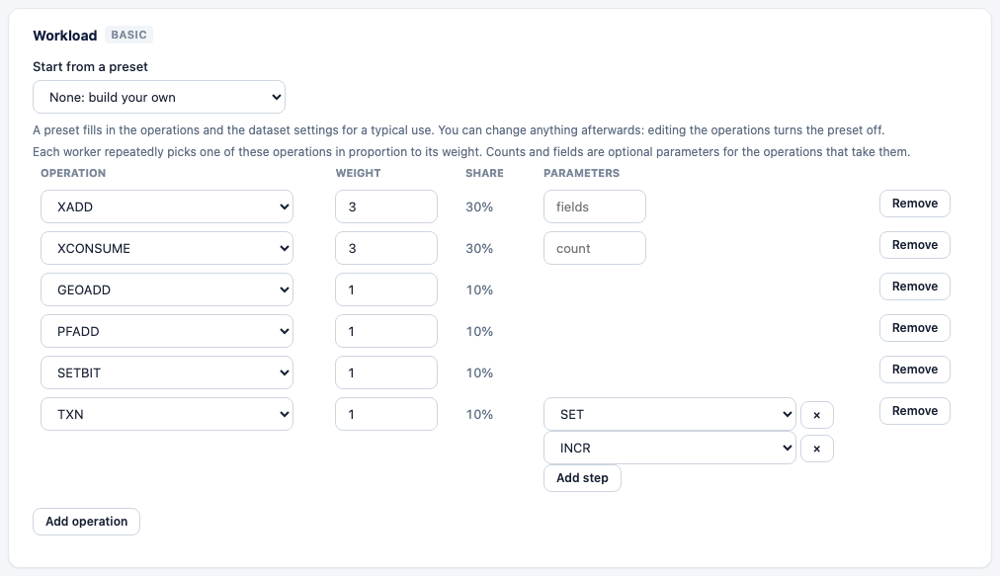
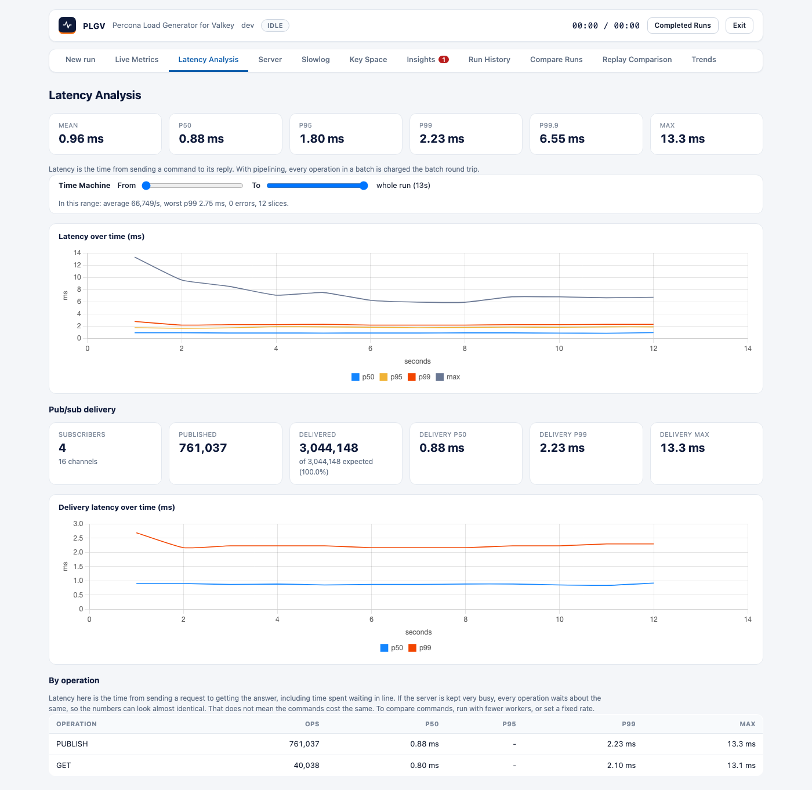

# Advanced commands

On top of the core data types, plgv can drive streams, blocking reads, pub/sub, geo, HyperLogLog, bitmaps,
transactions, Lua scripts and functions. Each one is an operation in `workload.mix`, and you use it like any
other (`examples/` has one file per family). Nothing here runs unless you add it.



## How operations run

- **Simple** operations are pipelined in a batch with the rest of the mix.
- **Solo** operations (blocking reads, `XCONSUME`, scripts) get their own call and their own latency. That way a
  200 ms wait never inflates its neighbours.
- **Composite** operations (`TXN`, `PIPELINE`, `WATCH_INCR`, `XCONSUME`) are several commands run as a unit on
  one connection, and they're recorded as one operation.

## Operations

| Family | Operations | Notes |
|---|---|---|
| Streams | `XADD`, `XLEN`, `XRANGE`, `XREAD`, `XREAD_BLOCK`, `XTRIM`, `XPENDING`, `XREADGROUP`, `XCONSUME` | `XADD` caps streams with `MAXLEN ~`. `XCONSUME` = `XREADGROUP` then `XACK`; `XREADGROUP` alone leaves entries pending. Preload creates the consumer group. `dataset.stream_length` entries per stream (default 20). |
| Blocking | `BLPOP`, `BRPOP`, `XREAD_BLOCK` | `timeout` (default 1s). A timeout is a **miss**. |
| Geo | `GEOADD`, `GEOPOS`, `GEODIST`, `GEOSEARCH` | Members come from `collection_size`. |
| HyperLogLog | `PFADD`, `PFCOUNT` | |
| Bitmaps | `SETBIT`, `GETBIT`, `BITCOUNT` | `dataset.bitmap_bits` (default 10000). |
| Scripts | `EVAL`, `EVALSHA`, `FCALL` | `script`: `rate_limit`, `incr_cap` or `get_set` (built in), or inline Lua in `source` (`EVAL` only). `args` are passed as `ARGV`. Scripts and the `plgv` function library are loaded on every node before the run. |
| Pub/Sub | `PUBLISH`, `SPUBLISH` | Needs `workload.pubsub.subscribers` to measure delivery. |
| Transactions | `TXN`, `PIPELINE`, `WATCH_INCR` | `TXN` runs `steps` in `MULTI`/`EXEC`; `PIPELINE` sends them in one round trip without a transaction. `WATCH_INCR` is `WATCH`, `GET`, then `MULTI`/`SET`/`EXEC`; an aborted transaction is a **miss**. |

`steps` only take simple operations, so no nesting, blocking, pub/sub or raw commands. In a **cluster**, `TXN`
needs `dataset.hash_tag_groups` above 0 so its keys share a slot. If it isn't set, plgv refuses to start.

## Pub/Sub

```yaml
workload:
  pubsub: {subscribers: 4, channels: 16, sharded: false}
  mix: [{op: PUBLISH, weight: 10}]
```

Each subscriber listens to every channel, so the expected number of deliveries is `published x subscribers`. The
publish time travels in the message, so delivery latency is measured end to end. After the run, plgv waits for
in-flight messages and reports delivered, expected, the ratio, and p50/p95/p99.

`sharded: true` uses `SSUBSCRIBE` and `SPUBLISH` (cluster shard channels, with hash-tagged names). With 0
subscribers, plgv only publishes.



## Findings

| Rule | Fires when |
|---|---|
| `watch-conflicts` | 5% or more of `WATCH_INCR` transactions were aborted (warning at 25%). |
| `blocking-timeouts` | Half or more of blocking reads timed out. |
| `streams-ran-dry` | 80% or more of group reads found nothing. Add `XADD` or raise `stream_length`. |
| `pubsub-loss` | Under 99% of expected messages arrived (critical under 90%). |
| `dangerous-commands-allowed` | `allow_dangerous` was on. |

## Web UI

Operations are grouped by family. The Parameters column only shows what applies: count, fields, key type,
timeout, a script (or inline Lua) with arguments, a steps editor for `TXN` and `PIPELINE`, or a command for
`RAW`. Pub/Sub subscribers, `stream_length` and `bitmap_bits` are Advanced settings.

## CLI

The relevant flags are `-subscribers N`, `-channels N`, `-raw-file` and `-allow-dangerous`. See [cli.md](cli.md).
