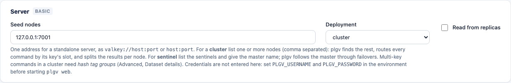
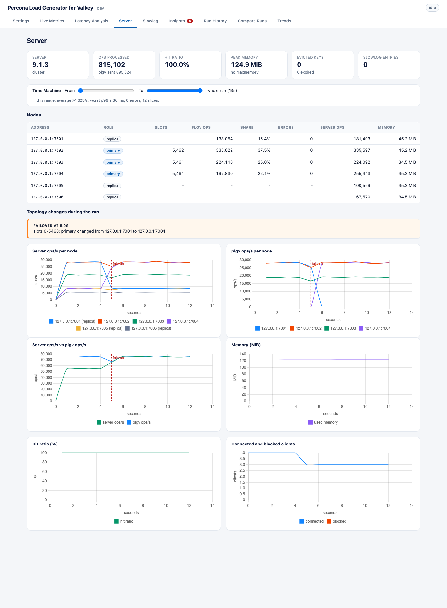
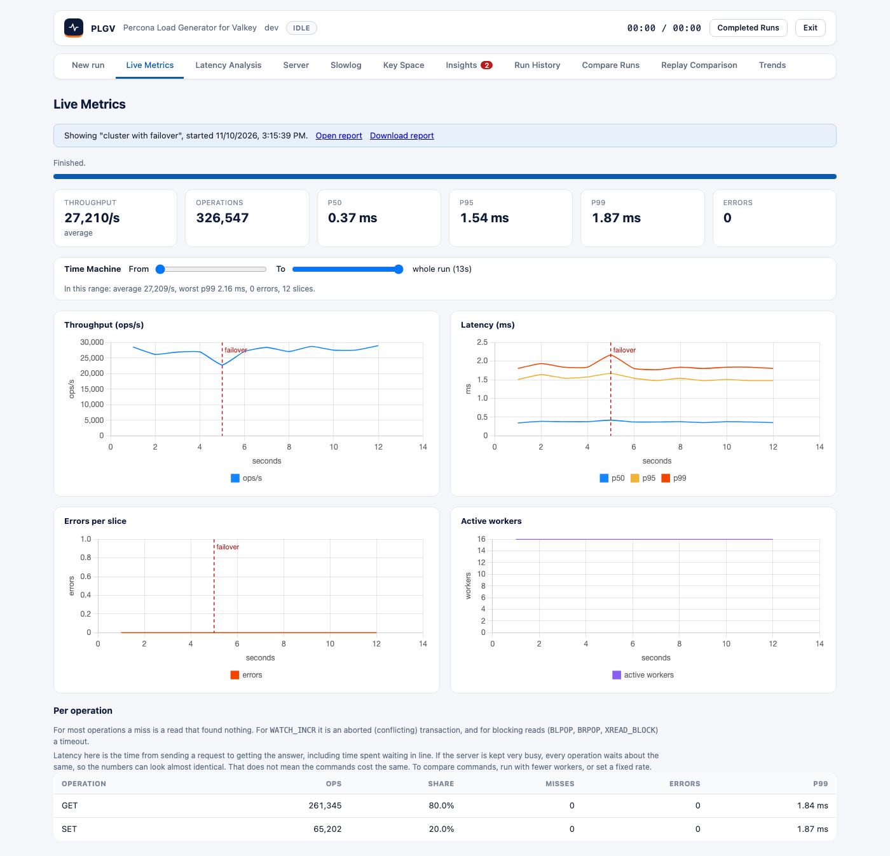
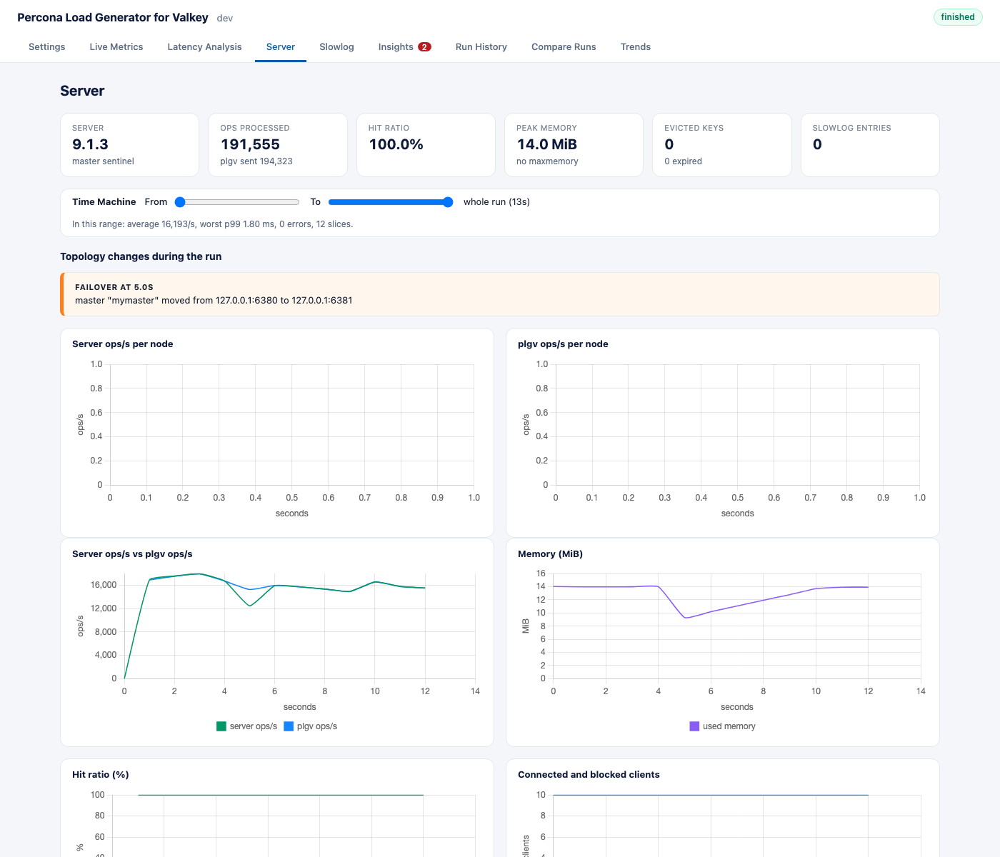

# Cluster and Sentinel

plgv can load a Valkey **cluster** or a **Sentinel**-managed primary/replica set, not just a single server. It
routes every command the way a real client would, splits the results per node, reads the cluster's topology
during the run, and marks failovers and reshards on the charts.

- [Set it up](#set-it-up)
- [Cluster mode](#cluster-mode)
- [Hash tags and multi-key commands](#hash-tags-and-multi-key-commands)
- [Reading from replicas](#reading-from-replicas)
- [What you see](#what-you-see)
- [Failovers and reshards](#failovers-and-reshards)
- [Sentinel mode](#sentinel-mode)
- [Insights for clusters](#insights-for-clusters)
- [Limits](#limits)
- [Try it locally](#try-it-locally)

## Set it up

| Setting (YAML) | Web UI | Meaning |
|---|---|---|
| `target.mode` | **Deployment** | `auto` (the default, which detects standalone or cluster after connecting), `standalone`, `cluster` or `sentinel`. plgv never detects Sentinel, so you have to choose it. |
| `target.uris` | **Server address / Seed nodes / Sentinel addresses** | One address (standalone), one or more cluster nodes (plgv finds the rest), or the sentinels. Separate several addresses with commas. |
| `target.sentinel.master_name` | **Master name** | The master set the sentinels monitor (Sentinel mode). |
| `target.read_from_replicas` | **Read from replicas** | Send read-only commands to replicas (cluster or Sentinel). Off by default. |
| `dataset.hash_tag_groups` | **Hash tag groups** (Advanced) | Put a `{group}` tag in every key so multi-key commands work in a cluster. 0 means no tags. |



Command line:

```bash
./bin/plgv run -addr 127.0.0.1:7001 -mode cluster -hash-tags 16 -server-metrics
./bin/plgv run -addr 127.0.0.1:7001,127.0.0.1:7002 -replica-reads     # seed nodes, reads from replicas
./bin/plgv run -mode sentinel -addr 127.0.0.1:26379,127.0.0.1:26380 -sentinel-master mymaster
```

You have to use the `valkey-go` client library (the default). `go-redis` only supports standalone targets, and the
configuration rejects it for cluster and Sentinel.

## Cluster mode

plgv connects to the seed nodes, learns the slot map, and sends each command to the node that owns its key's
slot. It follows redirects (`MOVED`, `ASK`) automatically and refreshes the slot map when the cluster changes.
Preload, pipelining, load profiles, sweeps and the open loop all work the same way as they do against one
server.

In `auto` mode, plgv asks the server (`INFO cluster`) and uses cluster mode if it finds a cluster. If your
settings don't match the server, plgv refuses with a clear message. That happens with `mode: cluster` against a
standalone server, `mode: standalone` against a cluster node, or `read_from_replicas` against a standalone
server.

## Hash tags and multi-key commands

A cluster refuses a multi-key command whose keys live in different slots (`CROSSSLOT`). plgv's multi-key
operations are `MGET` and `MSET`. Set `dataset.hash_tag_groups` to N (for example 16) and every key gets a tag,
like `plgv:{7}:s:1234`, where the tag is the key's index modulo N. Keys with the same tag share a slot, and a
multi-key command always draws its keys from one group.

- Without tags, plgv refuses a workload with `MGET` or `MSET` (more than one key) **before any traffic**, and
  gives you advice, instead of failing on every call.
- A group count above the number of keys is refused.
- Tags also decide how the load spreads. 16 groups over 3 primaries is even, while 1 group puts everything on
  one node.
- Preload writes exactly the same key names that the workload uses.

## Reading from replicas

With `read_from_replicas` on, a replica may answer read-only commands (`GET`, `MGET`, `HGET`, `ZRANGE` and the
other reads in [workloads.md](workloads.md)). Writes always go to the primary. Replicas can lag, so a read may
return older data.

A replica also executes the writes it replicates. So with replica reads (and after a failover), the sum of the
nodes' operations no longer equals what plgv sent. plgv tells you this (`server_ops_exact`) and doesn't raise
the client/server mismatch finding in that case.

## What you see

With **server metrics** on, the **Server** tab of a cluster run adds these:



- **Nodes table:** every primary and replica, with its role, slots, **plgv ops** and **share** (how many
  operations plgv sent to that node, based on its own slot routing), client **errors**, the **server ops** the
  node counted itself, and memory. The two counts agree node by node, differing by a few hundred operations at
  most. That's a check that the slot routing is right.
- **Charts:** server ops/s per node and plgv ops/s per node, plus the usual server charts for the cluster as a
  whole. The totals add up the primaries, or all nodes when you use replica reads.
- **Topology changes:** every failover, reshard, and node going down or coming back, with its time.
- The command-line output has the same node table.

Per-node data needs server metrics. It costs a `CLUSTER SHARDS` poll per interval and an `INFO` poll per node.
Without server metrics, a cluster run still works, but the results aren't split per node.

The run record keeps all of it (`client.nodes`, `server.nodes`, `server.topology`), and run history marks
cluster runs.

## Failovers and reshards

plgv reads the topology every polling interval (default one second) and compares it with the previous one:

| Event | Detected as |
|---|---|
| **failover** | The primary of a shard changed (slots `0-5460: primary changed from A to B`) |
| **reshard** | Slot ownership changed without a primary change |
| **node-down / node-up** | A node's health changed, or it left the cluster view |
| **cluster-state** | `cluster_state` went to `fail`, or back to `ok` |

Each event is drawn as a dashed red line at its time on the throughput, latency, error and per-node charts. It's
also listed under **Topology changes** and raised as an insight. The slot router follows the change, so after a
failover the new primary is the node that receives the operations.



In the run above, a graceful failover (`CLUSTER FAILOVER` on a replica) at 5 seconds caused a small dip in
throughput and a latency bump, but no errors. An abrupt failure, such as a killed primary, shows errors and a
longer gap until the replica takes over.

Detection is only as precise as the polling interval. Lower `server_metrics.interval` (minimum 100ms) to time
events more precisely.

## Sentinel mode

Set `mode: sentinel`, list the sentinels in `uris` and give the master name. plgv asks the sentinels for the
master and follows it through failovers (the client does this itself). With server metrics on, plgv also polls
the sentinels for the master's address. When it changes, plgv records a **failover** (`master "mymaster" moved
from 127.0.0.1:6380 to 127.0.0.1:6381`), with the same markers and insight. The usual server metrics come from
the current master.



Sentinel runs have no per-node table, because plgv follows the master, not every replica. You can still send
reads to replicas with `read_from_replicas`.

## Insights for clusters

| Finding | Fires when |
|---|---|
| `failover-during-run` | A primary was replaced (cluster or sentinel). Warning. |
| `reshard-during-run` | Slot ownership changed during the run. Warning. |
| `node-down` | A node stopped answering. Warning. |
| `cluster-not-ok` | `cluster_state` was `fail` at some point. Critical. |
| `hot-node` | One of at least 3 nodes got 2x its fair share of operations (a Zipf distribution, or too few hash tag groups). Info. |
| `uneven-slots` | A shard owns more than 20% above or below the average number of slots. Info. |
| `redirects` | The servers answered commands with `MOVED` or `ASK`. Info, and warning at 1% of operations or more. A steady workload that's routed correctly gets none. |

See [insights.md](insights.md) for all findings.

## Advanced commands

All the advanced operations work in a cluster. Keys are routed by their declared key (scripts by `numkeys`, and
stream reads by the key after `STREAMS`). `TXN` needs `dataset.hash_tag_groups` above 0. Sharded pub/sub
(`workload.pubsub.sharded`) uses hash-tagged channels. See [advanced-commands.md](advanced-commands.md).

## Presets and key space

Every [preset](presets.md) runs in a cluster, and the [key-space analysis](key-space-analysis.md) scans every primary.

## Limits

- Cluster and Sentinel need the `valkey-go` client library.
- Credentials come from the environment, as everywhere else. For TLS and ACL users, see
  [security-tls-acl.md](security-tls-acl.md).
- Topology and per-node data need **server metrics** on.
- Latency isn't split per node, because pipelined batches span nodes. Latency is reported for the whole run and
  per operation. Per-node operations, errors and server-side metrics are split.
- Failover timing is only as precise as the polling interval. The server's own failover time (how long writes
  are refused) shows up as the dip in the charts, not as a separate number.
- Sentinel runs only report the master (see above).

## Try it locally

```bash
make valkey-cluster-up        # 6 nodes on 127.0.0.1:7001-7006
make valkey-sentinel-up       # primary 6380, replica 6381, sentinels 26379-26381
./bin/plgv run -addr 127.0.0.1:7001 -mode cluster -hash-tags 16 -server-metrics
```

To see a failover, start a run and then promote a replica while it's running:

```bash
docker exec plgv-valkey-c1 valkey-cli -p 7004 cluster failover      # cluster
docker exec plgv-sentinel-primary valkey-cli -p 26379 sentinel failover mymaster   # sentinel
```

Afterwards, put the topology back by running `cluster failover` on the original primary, or another `sentinel
failover`. The cluster and Sentinel tests do this themselves. See [../TESTING.md](../TESTING.md).
