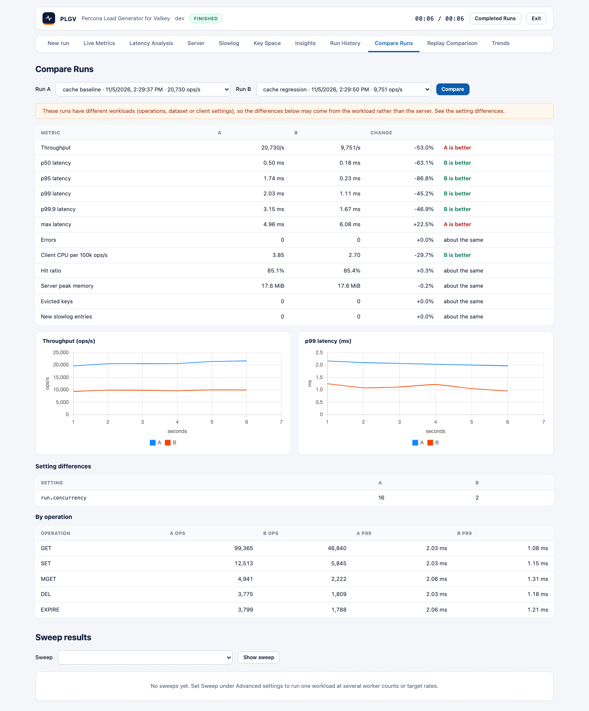

# Compare Runs

Compare two stored runs side by side: pick **Run A** and **Run B** on the tab, or select two runs
in Run History and click **Compare selected**. Differences are shown as B relative to A.

## What you see

- **Metrics table:** throughput; p50, p95, p99, p99.9 and max latency; errors; client CPU per
  100k ops/s. When both runs have server metrics: hit ratio, peak server memory, evicted keys and
  new slowlog entries.
- **Verdict:** each row says which run is better (higher is better for throughput and hit
  ratio; lower for the rest) or "about the same" when the two are within 2%.
- **Charts:** throughput and p99 over time for both runs.
- **Setting differences:** every setting that differs between the two configurations (output
  settings are ignored).
- **By operation:** operations and p99 for each operation in either run.
- **Findings that differ:** insight rules that fired in only one of the runs.

## Same workload or not

If the two runs have different workload fingerprints (a different mix, dataset, pipeline depth
or client library) a warning says the differences may come from the workload rather than the
server. The setting differences table shows exactly what changed. Comparing the same workload
against two servers or two server versions is the intended use.

## Reading the numbers

- Pipelined runs charge every operation in a batch the batch round trip, so latency is not
  comparable between a pipelined and an unpipelined run.
- Short runs are noisy; compare runs of similar length, and repeat a run before trusting a small
  difference.

## Sweep results

Below the two-run comparison, **Sweep results** shows a whole sweep (one workload at several worker
counts or target rates) as a table with charts and plain-language notes. See
[load-profiles-and-sweep.md](load-profiles-and-sweep.md).
