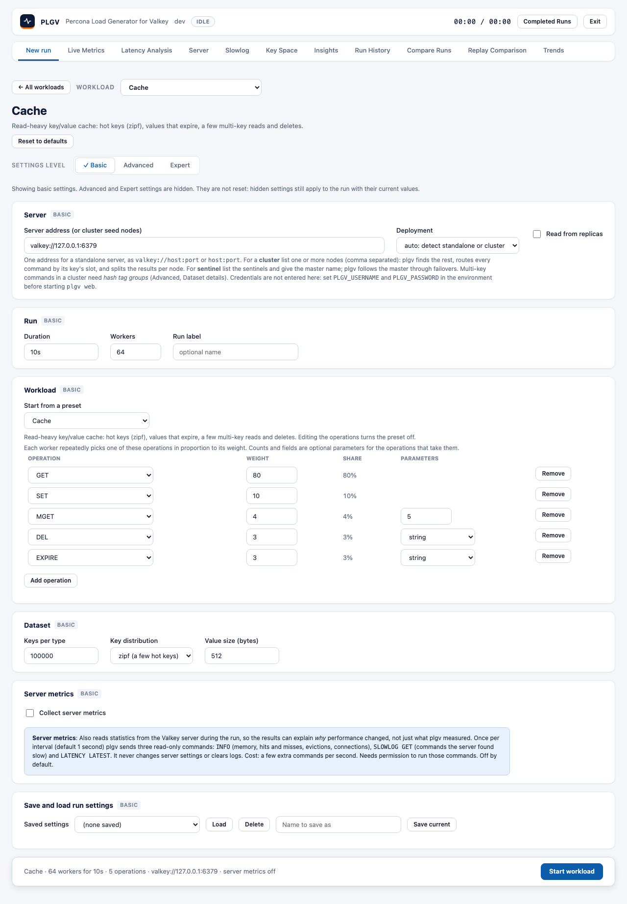

# Custom workload builder

The **Workload** card is where you build the operation mix: which commands to run, and in what proportion. To get
there, pick **Custom workload** on the front page, or pick any workload and edit it. Every worker keeps picking
one entry by weight and sending it.

## Using it

- Each row is one operation. Choose the **Operation** (grouped by Strings, Keys, Hashes, Lists, Sets and Sorted
  sets) and set its **Weight**. The **Share** column shows its percentage of the mix. Weights are relative, so
  80 and 20 is the same as 4 and 1.
- **Add operation** adds a row, and **Remove** deletes one. You need at least one row.
- Some operations take parameters. The builder only shows the ones that apply:

| Parameter | Shown for | Meaning |
|---|---|---|
| count | `MGET`, `MSET`, `LRANGE`, `ZRANGE`, `ZRANGEBYSCORE`, `SRANDMEMBER`, `SCAN` | Keys per call, elements returned, or scan page size. |
| fields | `HSET` | Fields written per call (up to the dataset's hash fields). |
| type | `DEL`, `UNLINK`, `EXISTS`, `TTL`, `EXPIRE`, `SCAN` | Which key type to act on: string, hash, list, set or sorted set. |

If you change an operation, the builder drops any parameters the new one doesn't take, so a stale value never
gets sent.

## The dataset behind the mix

Keys live in one namespace per type, so a mixed workload never runs into a key of the wrong type. On the
**Dataset** card you set the keys per type, the key distribution (uniform, or Zipf for a few hot keys) and the
value size. At the Advanced level you can also set the collection size, hash fields, TTL model and preload.
See [workloads.md](workloads.md) for what each operation does, and
[configuration-reference.md](configuration-reference.md) for every setting.

## Validation

If a mix can't run (for example, a parameter on an operation that doesn't take it, or a weight below 1), you'll
see the problem next to the field when you start the run.

If you like a mix, save it with **Save current** (see [settings-levels.md](settings-levels.md)).
