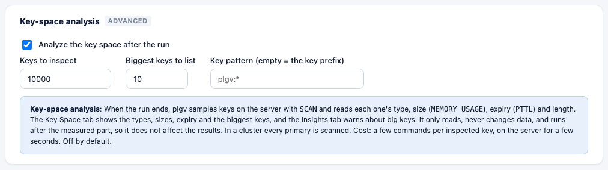
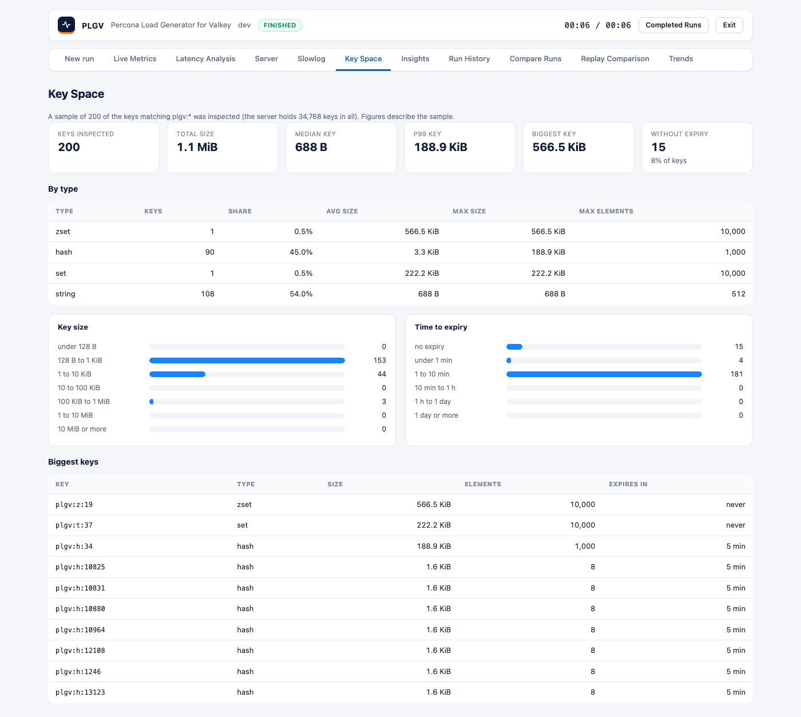

# Key-space analysis

After a run, plgv can look at what the data on the server turned out like: which types, how big, how long they
live, and which keys are the biggest. It helps you answer questions like "why is `HGETALL` slow?" (maybe a hash
has 100,000 fields) and "how much memory does this dataset really take?"

It's **off by default**.



## Turn it on

- **CLI:** run `plgv run -keyspace`, and add `-keyspace-samples 20000` if you want to set the sample size.
- **YAML** (`examples/keyspace.yaml`):

  ```yaml
  keyspace_analysis:
    enabled: true
    samples: 10000   # keys to inspect (100 to 1,000,000)
    top: 10          # biggest keys to list (1 to 100)
    match: ""        # SCAN pattern; empty = the dataset's key prefix, for example plgv:*
  ```

- **Web UI:** switch to Advanced, then open *Metrics and reporting* and *Key-space analysis*.

## What it does

It runs after the measured part of the run has ended, so it never affects your results. plgv does this:

1. It runs `SCAN` for up to `samples` keys that match the pattern. In a **cluster** it scans every primary and
   splits the samples between them.
2. For each key, it reads `TYPE`, `MEMORY USAGE key SAMPLES 5`, `PTTL` and a length command (`STRLEN`, `HLEN`,
   `LLEN`, `SCARD`, `ZCARD` or `XLEN`).

It only reads. It never changes or deletes data. The cost is four commands per inspected key, and the analysis
stops after 5 minutes. If the server refuses a command (because of an ACL), or the pattern matches nothing, the
result tells you so instead of showing empty tables.

If the server holds more matching keys than `samples`, the figures describe the first keys that `SCAN`
returned, and those aren't random. Raise `samples` to see more. When every matching key was inspected, the
report says "all".

## What you see

The **Key Space** tab shows the following. You'll find the same information in the HTML report, in the JSON
summary under `keyspace`, and in the `plgv run` output.


- Keys inspected, total size, median, p99 and biggest key, keys over 1 MiB, keys without expiry.
- A table by type: keys, share, average and maximum size, maximum elements.
- Histograms of key size and of time to expiry.
- The biggest keys with type, size, elements and time to expiry.



The **big-keys** finding ([insights.md](insights.md)) is raised when a key is 1 MiB or more
(warning at 10 MiB), or a collection has 100,000 elements or more.

## Notes

- `MEMORY USAGE` estimates a collection from 5 sampled elements, so it's close but not exact.
- Bitmaps, HyperLogLogs and geo sets appear as `string` and `zset`, because that's how Valkey types them.
- Keys that expire during the analysis are counted as "gone", not as errors.
