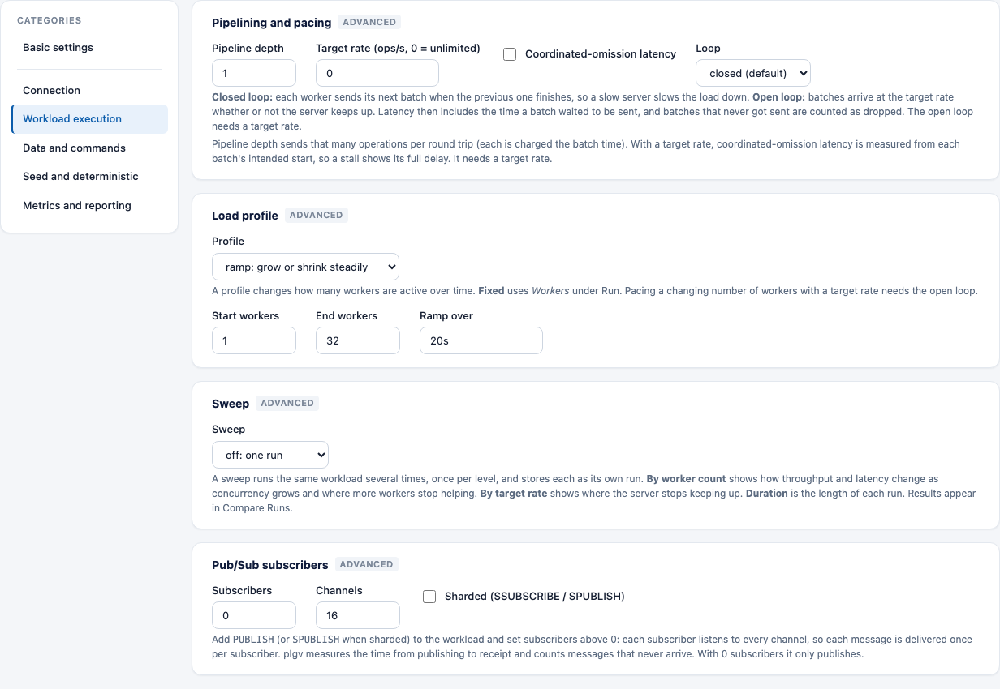
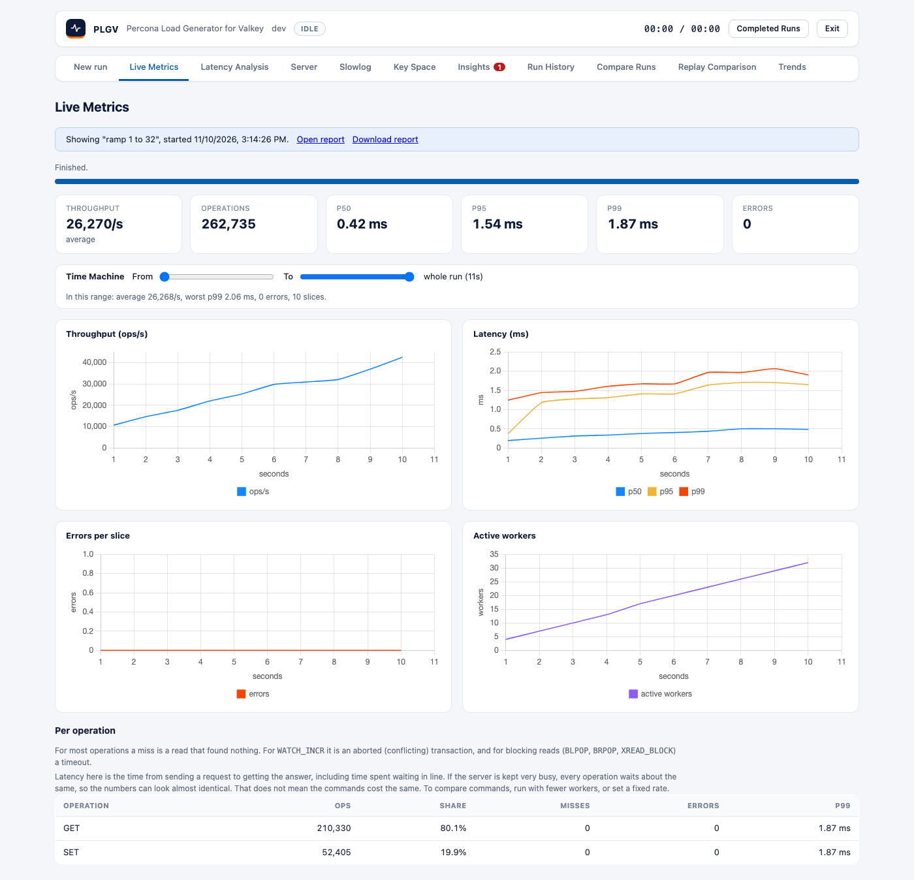
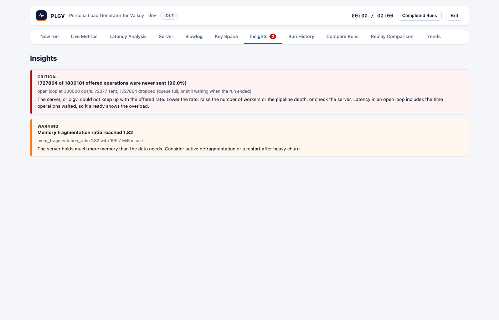
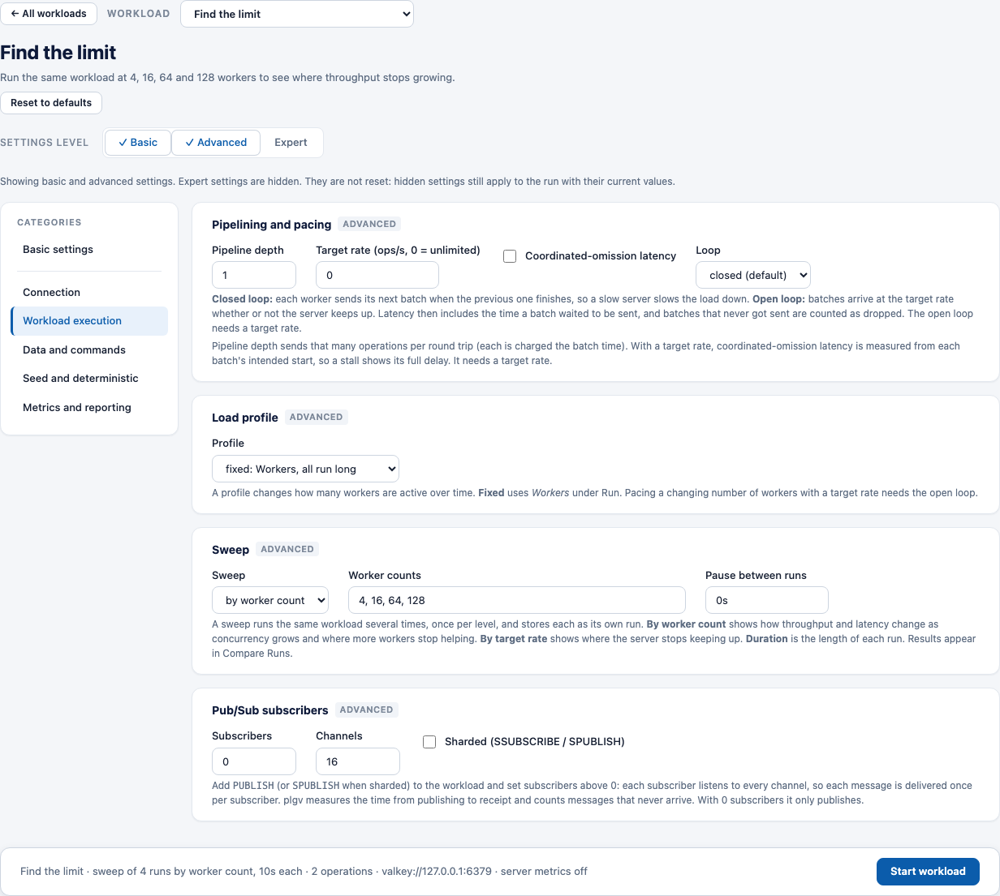
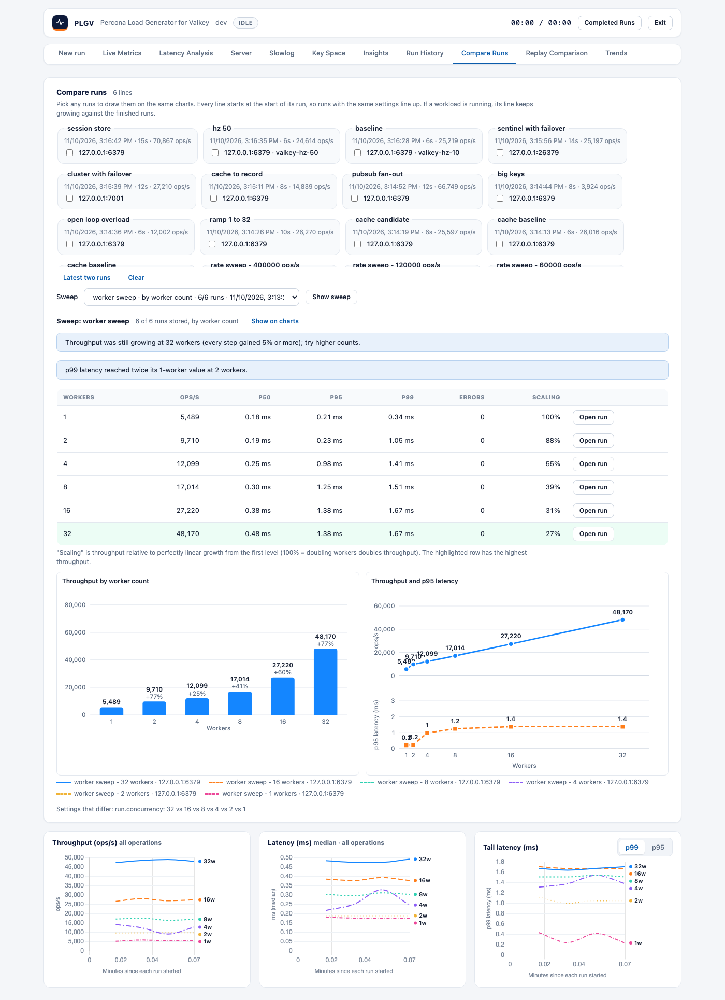
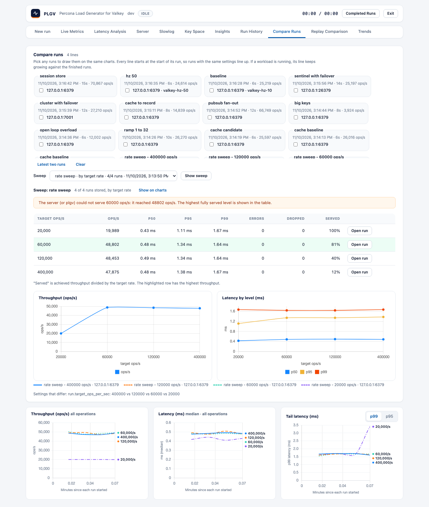

# Load profiles, open loop and sweeps

There are three ways to shape a run beyond "N workers for T seconds". All of them are off by default and live
under **Advanced** settings in the web UI (`run.load_profile`, `run.loop` and `run.sweep` in YAML).

- [Load profiles](#load-profiles) change the number of active workers over time.
- [Open and closed loop](#open-and-closed-loop) decides who controls when the next request is sent.
- [Sweeps](#sweeps) run the same workload at several worker counts or rates so you can compare them.
- [Time Machine](#time-machine) lets you look at one part of a run.

## Load profiles

A profile says how many workers are **active** at each moment. plgv starts as many workers as the profile's
peak, and the rest sit idle until the profile calls for them.

| Profile | What it does | Settings |
|---|---|---|
| `fixed` (default) | The same number of workers all run long (**Workers** under Run). | none |
| `ramp` | Moves steadily from one worker count to another. | `start_workers`, `end_workers`, `ramp_over` |
| `step` | Holds a worker count for a time, then the next stage. | `steps`: a list of `workers` and `duration` |
| `spike` | A base number of workers, jumping to a peak for a window. | `base_workers`, `peak_workers`, `spike_at`, `spike_for` |
| `sine` | Smooth periodic load between a minimum and a maximum. It starts at the trough so the run warms up. | `min_workers`, `max_workers`, `period` |

```yaml
run:
  duration: 30s
  load_profile:
    kind: ramp
    start_workers: 1
    end_workers: 32
    ramp_over: 20s
```

(That's `examples/ramp.yaml`.) In the web UI, switch to **Advanced**, open **Workload execution** and choose
**Load profile**. You only see the fields for the profile you chose, and `step` has a small table of stages.



- The run ends at **Duration**, whatever the profile says. If the profile is shorter than the run, it holds its
  last value.
- **Live Metrics** has an **Active workers** chart, and every stored run records the active worker count for each
  time slice, so you can line throughput up with concurrency.



- A target rate with a changing number of workers needs the open loop (see below). If you combine it with the
  closed loop, plgv rejects it with a message.

## Open and closed loop

| Loop | How it works | Use it for |
|---|---|---|
| **closed** (default) | Each worker sends its next batch when the previous one finishes, so a slow server slows the load down. | Finding the most the server can do with N clients. |
| **open** | Batches are *offered* at the target rate whether or not the server keeps up, and workers take them as they become free. | Answering "what would users see at this request rate?" |

In the open loop:

- It needs a **target rate** (`run.target_ops_per_sec`). The rate applies to the whole run and is split into
  batches of **pipeline depth** operations.
- **Latency is measured from the moment a batch was due**, so time spent waiting for a free worker counts. This
  is the coordinated-omission-aware view (see [metrics-and-server-stats.md](metrics-and-server-stats.md)), and
  you don't need to turn on the separate setting.
- If the server or plgv can't keep up, offered batches pile up in a queue (about ten seconds' worth) and then
  get dropped. Batches still queued when the run ends are dropped too. The result shows **dropped operations**,
  and the **Insights** raise `arrivals-dropped` once 0.5% or more of the offered operations were never sent
  (critical at 5%). A handful left over at the end is normal and isn't reported.



Here's an example (`examples/open-loop.yaml`) that offers 50,000 ops/s for 20 seconds:

```bash
./bin/plgv run -loop open -target-ops 50000 -workers 64 -duration 20s
```

## Sweeps

A sweep runs the same workload several times, once per **level**, and stores each one as its own run. Use it to
see how throughput and latency change as concurrency grows, and where the server stops keeping up.

| Sweep | Levels | Each run uses |
|---|---|---|
| **by worker count** | 2 to 8 whole numbers, 1 to 10000 | that many workers |
| **by target rate** | 2 to 8 rates in ops/s, above 0 | that target rate |

The settings are `run.sweep.kind` (`none`, `workers` or `rate`), `values`, and `pause` (how long to wait between
runs, none by default). **Duration is the length of each run**, not of the whole sweep. A sweep needs the
`fixed` load profile and, for a rate sweep, no target rate of its own.

### Run one

In the web UI, the **Find the limit** card on the front page sets up a worker sweep (4, 16, 64, 128) for you.
Or open **Workload execution** (Advanced), choose **Sweep**, pick a kind and list the levels (`4, 8, 16, 32`).

The launch bar says "sweep of 4 runs by worker count, 10s each". **Live Metrics** shows a banner (`Sweep of 4
runs ... Level 2 of 4: 8 workers`) and moves through the levels by itself. Each finished level is stored right
away, so **Stop** keeps the levels you've already done. The one you interrupted is saved and marked stopped.



Command line:

```bash
./bin/plgv run -sweep-workers 4,8,16,32 -duration 10s            # by worker count
./bin/plgv run -sweep-rates 10000,20000,40000 -duration 10s      # by target rate
./bin/plgv run -config examples/sweep.yaml
```

The command prints each level and then a results table. If you pass `-summary out.json`, each level is written
to its own file (`out-1.json`, `out-2.json`, ...).

```
sweep results:
  workers             ops/s        p50        p95        p99   errors   scaling
  2                   10863      176µs      205µs      377µs        0      100%
  8                   31331      193µs      786µs    1.507ms        0       72%
  32                  67010      303µs    1.475ms    1.737ms        0       39%
  Throughput was still growing at 32 workers (every step gained 5% or more); try higher counts.
  p99 latency reached twice its 2-worker value at 8 workers.
```

### Read the results

Open **Compare Runs**. The sweep results are in the card at the top. Pick the sweep in the **Sweep** list if there
is more than one, and click **Show on charts** to draw its runs on the charts. You can also click **Compare this
sweep** after a run, or **Compare sweep** on a row in Run History. Opening a sweep this way ticks all of its runs,
so they are drawn on the three charts under the card (throughput, latency and tail latency).



- The **table** has one row per level, with throughput, p50, p95, p99, errors and a last column:
  - **Scaling** (worker sweep) is throughput relative to perfectly linear growth from the first level. 100%
    means doubling the workers doubled the throughput.
  - **Served** (rate sweep) is the achieved throughput divided by the target rate, plus a **Dropped** column
    for open-loop runs.
  - The row with the highest throughput is highlighted, and **Open run** opens that level.
- The **figures** for a worker sweep are **Throughput by worker count** (bars, with the gain over the previous
  level) and **Throughput and p95 latency** (lines). The shaded area, "More workers stop helping", starts at the
  first level that gained less than 5%. A rate sweep shows throughput and latency charts against the target rate.
- The **notes** say in plain language what the numbers show:

| Note | When it appears |
|---|---|
| More workers stopped helping after N workers | The first step up that gained less than 5% in throughput. |
| Throughput was still growing at N workers | Every step gained 5% or more, so try higher counts. |
| p99 latency reached twice its first-level value at N workers | A level's p99 is at least 2x the first level's. |
| The server (or plgv) could not serve N ops/s | A rate level reached under 95% of its target, or dropped operations. |
| This sweep did not finish all of its levels / A level was stopped early | The numbers are only partial. |



### Make a sweep fair

- Keep **Preload** on. Every level rewrites the dataset first, so each one starts from the same data.
- If the server is shared with other applications, their load ends up in your numbers (the
  `client-server-mismatch` insight can tell you).
- To compare two servers, run a sweep on each and put the tables side by side.
- For a worker sweep, the machine running plgv needs enough CPU for the highest level. The
  `load-generator-bound` insight warns you when plgv itself is the limit.

### Sweep or load profile?

A **sweep** is a set of separate runs with fixed worker counts, so each level has clean percentiles and its own
report. A **ramp** or **step** profile changes the worker count inside one run. That's quicker, but it blends
the levels together in one set of percentiles.

## Time Machine

Above the charts on **Live Metrics**, **Latency Analysis** and **Server** you'll find the **Time Machine**. It
has two sliders, **From** and **To**, that choose a range of the run. All the charts in the view zoom to that
range, and a line shows the statistics for just that range: average throughput, worst p99, errors and the
number of one-second slices. **Show whole run** resets it.

- The range follows you between those three tabs, and starts fresh when you open another run.
- It's useful for looking at a ramp's top end, a spike, or the moment something went wrong, without the rest of
  the run getting in the way.
- A link can carry the range: `#run=<id>&tab=live&range=2-10`.
