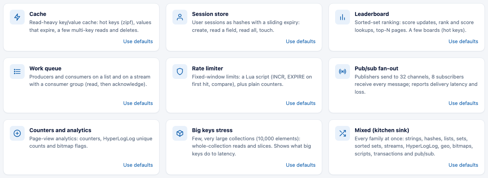

# Workload presets

A preset is a named starting point for a typical use. It gives you the operation mix, plus the dataset and
pub/sub settings that make it realistic. Presets are opt-in. If you don't pick one, you get the plain 80/20
GET/SET default.

```bash
./bin/plgv presets                       # list them
./bin/plgv run -preset cache -duration 30s
./bin/plgv config -preset session        # print the effective settings
```

In YAML (`examples/preset-cache.yaml`):

```yaml
workload:
  preset: cache
dataset:
  key_count: 50000     # overrides the preset's value; the rest of the preset stays
```

**Layering:** settings are applied in this order: defaults, then the preset, then your file, then command-line
flags. Anything you write wins over the preset. If you use `-preset` on the command line together with a config
file, the same order applies.

In the web UI, every preset is a card under **Typical applications** on the front page. Click one and its
settings open with the defaults already selected: the operations, the dataset settings, and the pub/sub
subscribers or worker count where the preset sets them. You can edit anything afterwards. If you edit the
operations, the preset turns off and the workload becomes a custom one.

To switch to another preset, use the **Workload** list at the top of the settings (or **Start from a preset** in
the Workload card). Your server, workers and duration stay as they are. A link such as `#preset=queue` opens
that workload directly.



Every preset works on a standalone server and in a cluster. The ones that need multi-key commands set
`hash_tag_groups: 16` (see [cluster-and-sentinel.md](cluster-and-sentinel.md)).

## cache

A read-heavy key/value cache. It uses Zipf keys (a few hot ones) and 512 B values with a random 60 to 600 s
expiry. The mix is `GET` 80, `SET` 10, `MGET` 4 (5 keys), `DEL` 3 and `EXPIRE` 3. Watch the hit ratio and the
effect of hot keys.

## session

User sessions stored as hashes. The mix is `HGET` 45, `EXPIRE` 20 (on hashes), `HSET` 15 (4 fields),
`HGETALL` 15 and `DEL` 5. Watch hash read latency and expiry churn.

## leaderboard

Sorted-set rankings on 1,000 boards (Zipf, so a few are hot) with 1,000 members each. The mix is `ZRANGE` 25
(top 10), `ZINCRBY` 20, `ZRANK` 20, `ZADD` 15, `ZSCORE` 15 and `ZCARD` 5.

## queue

Work queues, one on a list and one on a stream with a consumer group. The mix is `LPUSH` 25, `RPOP` 20,
`XADD` 20, `XCONSUME` 20 (read, then acknowledge), `LLEN` 5, `XPENDING` 5 and `XLEN` 5. A miss means the queue
was empty. See [advanced-commands.md](advanced-commands.md).

## rate-limiter

Fixed-window rate limits on 10,000 hot keys. The mix is a Lua script (`INCR`, `EXPIRE` on the first hit, then a
compare against the limit) 70, `INCR` 25 and `TTL` 5.

## pubsub-fanout

Publishers (`PUBLISH` 95, `GET` 5) send to 32 channels, and 8 subscribers receive every message. The results
show delivery latency and any lost messages.

## counters

An analytics workload: `INCR` 30, HyperLogLog `PFADD` 25 and `PFCOUNT` 10, and bitmaps (100,000 bits) with
`SETBIT` 20, `GETBIT` 10 and `BITCOUNT` 5.

## big-keys

A few big collections: 50 keys of 10,000 elements (hashes of 1,000 fields), with 16 workers. The mix is
`HGETALL` 20, `LRANGE` 20 (1,000), `ZRANGE` 20 (1,000), `SMEMBERS` 15, `SADD` 10, `ZADD` 10 and `HSET` 5.
Reading whole big collections shows up as tail latency. To see the key sizes, combine it with the
[key-space analysis](key-space-analysis.md): `./bin/plgv run -preset big-keys -keyspace`.

## mixed

The kitchen sink. It covers every family: strings, hashes, lists, sets, sorted sets, streams, HyperLogLog, geo,
bitmaps, a script, a transaction, `WATCH_INCR` and pub/sub (2 subscribers). Keys are Zipf-distributed over
20,000 keys.
