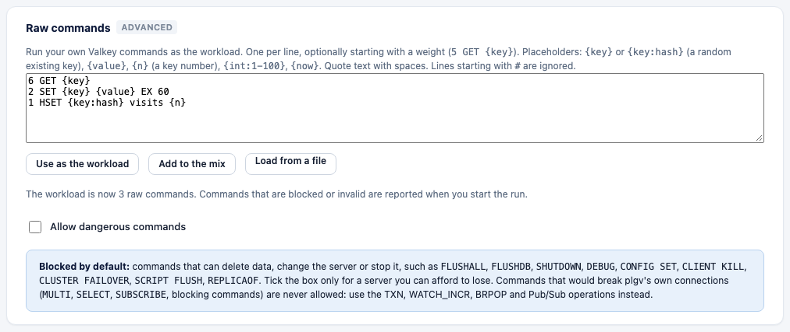

# Raw command injector

Run your own Valkey commands as the workload. Commands are mixed by weight, rate-limited and
measured like any other operation, and shown in the results under their own text.



## Writing commands

One command per line, optionally starting with a weight. `#` starts a comment.

```text
6 GET {key}
2 SET {key} {value} EX 60
1 HSET {key:hash} visits {n}
ZADD {key:zset} {int:1-1000} member{n}
```

Quote text with spaces (`"hello world"`). Placeholders:

| Placeholder | Becomes |
|---|---|
| `{key}`, `{key:TYPE}` | A key from the dataset (`string` by default; `hash`, `list`, `set`, `zset`, `stream`, `geo`, `hll`, `bitmap`), drawn with the key distribution. |
| `{value}` | A random value of `dataset.value_size`. |
| `{n}` | A key number. |
| `{int:LO-HI}` | A random integer in the range. |
| `{now}` | The current time in milliseconds. |

## Use it

- **CLI:** `plgv run -raw-file commands.txt` replaces the mix. In YAML use `op: RAW` with `command:`
  (`examples/raw.yaml`).
- **Web UI:** the **Your own commands** card opens *Data and commands* (Advanced) with example commands already
  used as the workload; replace them, or paste or load a file, then *Use as the workload* or *Add to the mix*. Problems are reported on the field when you start the run.

In a cluster plgv routes by the first key in the command. Keep one key per command, or use hash
tags.

## The blocklist

Checked before anything is sent; the run does not start if a command is blocked.

| Tier | Commands | How to get them |
|---|---|---|
| Dangerous | `FLUSHALL`, `FLUSHDB`, `SHUTDOWN`, `DEBUG`, `MONITOR`, `FAILOVER`, `SWAPDB`, `SAVE`/`BGSAVE`/`BGREWRITEAOF`, `MIGRATE`, `RESTORE`, `MODULE`, `REPLICAOF`/`SLAVEOF`, `CONFIG SET`/`RESETSTAT`/`REWRITE`, `CLIENT KILL`/`PAUSE`, `CLUSTER FAILOVER`/`RESET`/`FORGET` and other slot or membership changes, `SCRIPT FLUSH`/`KILL`, `FUNCTION FLUSH`/`DELETE`/`RESTORE`, `ACL SETUSER`/`DELUSER`, `SLOWLOG RESET`, `LATENCY RESET` | `workload.allow_dangerous: true`, `-allow-dangerous`, or the checkbox in the UI. The run summary and an insight record that it was on. Use a server you can lose. |
| Never | `MULTI`/`EXEC`/`WATCH`, `SELECT`, `AUTH`, `HELLO`, `RESET`, `SUBSCRIBE` and friends, blocking commands (`BLPOP`, `BZPOPMIN`, ...), `XREAD`/`XREADGROUP` with `BLOCK`, `SYNC`/`PSYNC` | Not allowed: they would break plgv's own connections. Use `TXN`, `WATCH_INCR`, `BRPOP`, `XREAD_BLOCK` and Pub/Sub. |

Credentials are never part of a command: use `PLGV_USERNAME`/`PLGV_PASSWORD`.
