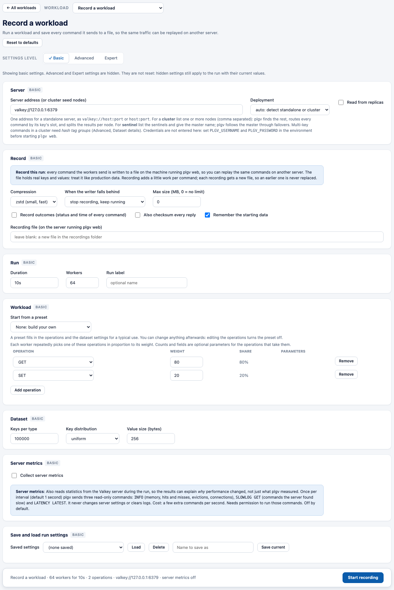
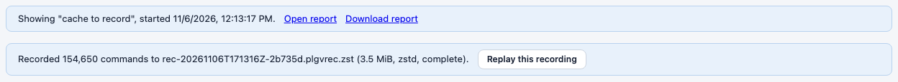
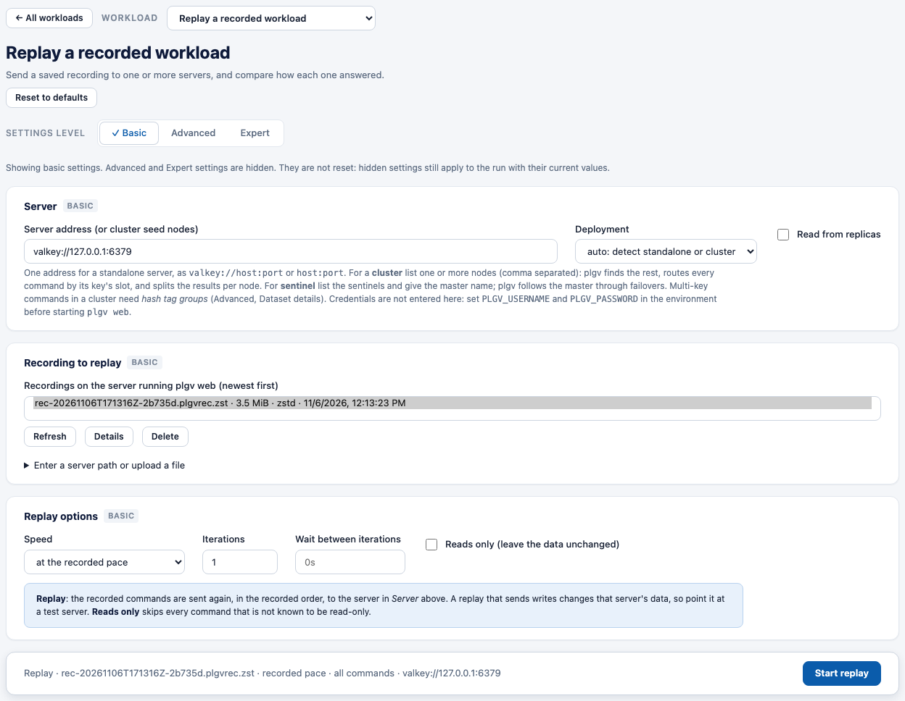
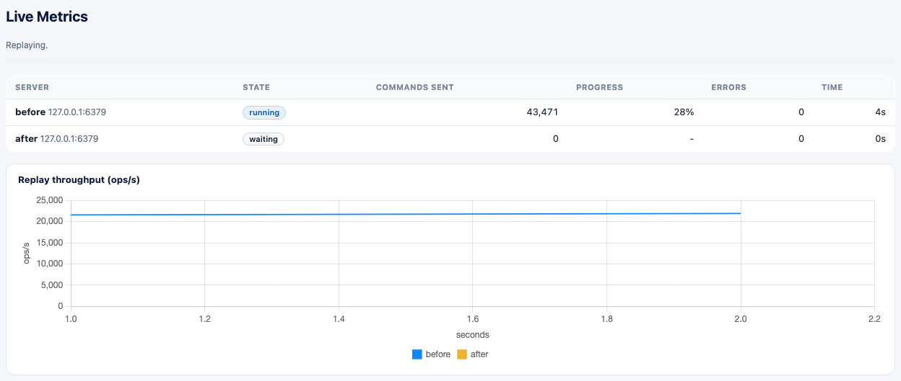
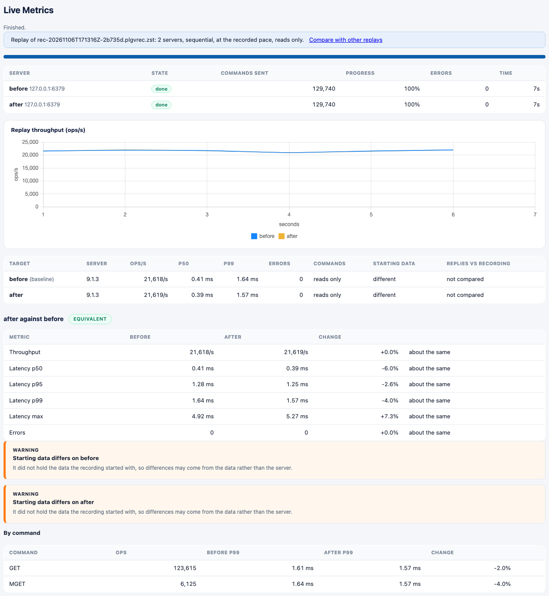
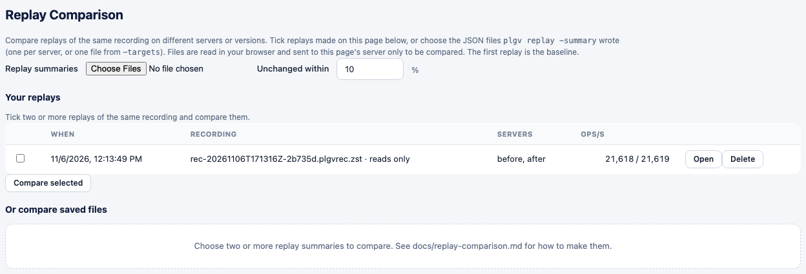
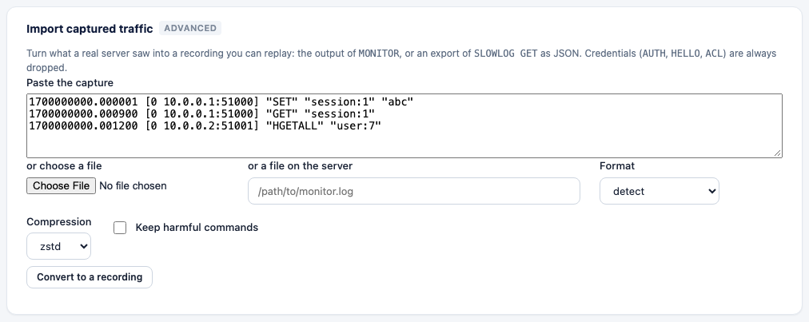

# Record and replay in the web UI

Record a workload, replay it on one or more servers, and compare the results without leaving the page.
Everything here is also available on the command line ([record-and-replay.md](record-and-replay.md)); both
use the same recording files and the same engine.

Both are **off by default**. Nothing is recorded unless you choose **Record a workload**, and a replay only
starts when you press **Start replay**.

> **Treat recordings like production data.** A recording holds the real keys and values of the run, in clear
> text. plgv writes it with mode `0600` and never puts the server address, user name or password in it, but the
> file still holds your data. Do not share it, and delete it when you are done.

## Record a workload

On the front page choose **Record a workload**. It opens the settings of a standard workload (80% `GET`,
20% `SET`) with a **Record** card. Change the workload as you would for any run: pick a preset in the
*Workload* card or build your own mix.

| Setting | Meaning |
|---|---|
| **Compression** | `zstd` (default here: small and fast), `gzip`, or `none` (plain text). |
| **When the writer falls behind** | *stop recording, keep running* (the default, `fail`): the recording ends and is marked failed, the run is not affected. *slow the workers so nothing is lost* (`block`): every command is recorded and throughput may drop. |
| **Max size (MB)** | Stop recording after this many uncompressed MB; the file is marked `truncated`. `0` = no limit. |
| **Record outcomes** | Also keep each command's status (`ok`, `miss`, `error`) and latency, so a replay can say which replies differ. |
| **Also checksum every reply** | Also keep a checksum of each reply (implies outcomes). Lets a replay tell that a command returned *different data*. |
| **Remember the starting data** | Store the key count and a key digest at the start, so each replay can tell whether its server holds the same data. On by default. |
| **Recording file** | Leave it blank. Every run then gets a new file, `rec-<UTC time>-<random>.plgvrec[.zst\|.gz]`, in the *recordings folder*, so an earlier recording is never replaced. Type a path only to choose where it goes (see *Typed paths* below). |

Press **Start recording**. The run is an ordinary run: Live Metrics, charts and the stored result in
**Completed Runs**. When it finishes, a banner says what was written:

If workers had to wait for the writer (`block`), the banner says how often and for how long. **Replay this
recording** opens the replay settings with that file chosen.

A sweep cannot be recorded (it runs several times and would overwrite the file); the *Record a workload* page
has no sweep.

## Replay a recording

Choose **Replay a recorded workload**. The **Server** card is where the replay goes. The settings that belong to
generating load (duration, workers, dataset, operations) do not apply and are not shown.

**Recording to replay** lists the recordings in the recordings folder, newest first, with size, command count
(for an uncompressed file), time, and whether it was imported. The newest is already chosen.

- **Details** reads the whole file and shows its status, command count and groups, workers, compression, size,
  when and on which server version it was recorded, whether it holds outcomes and a starting-data fingerprint,
  and the most frequent commands.
- **Delete** removes a recording from the recordings folder (never a file elsewhere).
- **Refresh** reads the folder again.
- **Enter a server path or upload a file** opens a path field and an upload button (below).

A file that looks like a recording but cannot be replayed is listed greyed out, with the reason.

**Replay options**

| Setting | Meaning |
|---|---|
| **Speed** | *at the recorded pace*, 2, 5 or 10 times faster, or *as fast as the server answers*. |
| **Iterations** and **Wait between iterations** | Replay the recording several times in a row. |
| **Reads only** | Skip every command that is not known to be read-only, so the target's data does not change. The result says how many were skipped, and the commands hash is not compared. |

Press **Start replay**. Live Metrics shows each server, its state (*waiting*, *running*, *done*, *failed*), the
commands sent, the progress against the recording and a throughput chart. **Stop** ends it early; what ran is
kept and marked as stopped.

### Several servers

Turn on **Advanced** and open **Workload execution**. **Replay on several servers** takes one server per line
as `name=host:port` (two to eight). The recording is replayed on each in turn, or all at once with *Replay on
all servers at the same time*, and each server is compared with the first. **Unchanged within** is the percent
a metric may change before it counts as better or worse.

All servers share the connection settings of the Server card (TLS, client library) and the credentials from
`PLGV_USERNAME` and `PLGV_PASSWORD`. A server that fails does not stop the others: it is listed with the reason.

**Replay checks** (also Advanced):

- *Stop if the server does not hold the data the recording started with* refuses a replay on different data.
  Without it, a mismatch is reported but the replay runs.
- *Allow harmful commands* lets `FLUSHALL`, `CONFIG SET`, `DEBUG` and similar run if an edited file holds
  them. They are refused by default.

### The result

When the replay finishes, the same page shows the result:

- One row per server: throughput, p50 and p99, errors, whether the commands sent match the recording
  (*as recorded*), whether the starting data matched, and, if the recording holds outcomes, how many replies
  differed from the recorded ones.
- For two or more servers, a comparison of each against the first, with a verdict (`faster`, `slower`,
  `mixed`, `equivalent`, `not comparable`), the metrics that changed, findings, and the per-command p99.
  How to read it: [replay-comparison.md](replay-comparison.md#how-to-read-it).

The replay is stored (in the data directory, `replays/`) and can be reopened later.

### Your replays

The **Replay Comparison** tab lists every stored replay. **Open** shows one again; tick two or more and press
**Compare selected** to compare replays made at different times (for example before and after an upgrade).
You can still compare files written by `plgv replay -summary`.

## Import captured traffic

To replay what a real server did, turn its `MONITOR` output or a `SLOWLOG` export into a recording. With
**Advanced** on, open **Data and commands** in the replay settings:

Paste the capture, choose a file from your computer, or (when typed paths are on) give a file on the server.
**Convert to a recording** writes a new recording into the folder and chooses it for the replay. The message
says how many commands were kept and what was left out (credentials, other databases, administration commands,
harmful commands). Credentials (`AUTH`, `HELLO`, `ACL`) are always dropped. Read
[traffic-import.md](traffic-import.md) before replaying imported writes.

Live capture (`MONITOR` on a running server) is not offered here, because it can slow the server down; use
`plgv import-traffic -capture` for that.

## Where files live, and typed paths

| What | Where |
|---|---|
| Recordings (recorded, imported, uploaded) | `<data-dir>/recordings/` (the page shows the exact folder) |
| Stored replays | `<data-dir>/replays/` |

The page never chooses a file name for you to overwrite. A new recording always gets a new name.

**Typed paths.** *Recording file* (Record), *Path of a recording* (Replay) and *a file on the server* (Import)
let you name a file on the machine running `plgv web`, as plgm does. Because the web UI has no login:

- Typed paths are available only while `plgv web` listens on a loopback address (the default). With
  `-allow-remote` they are turned off and the page says so; pick from the list or upload instead.
- A typed path for **reading** must be a regular file (not a folder or a link) that starts like a plgv
  recording; anything else is refused and its content is never shown.
- A typed path for **writing** must be in a folder that exists, and may only replace an earlier plgv recording:
  a file that is not a recording is never overwritten.
- **Delete** works only inside the recordings folder.
- An upload is stored inside the recordings folder under a new name, checked to be a recording, and limited to
  2 GB.

## From a script or a link

`#task=record` and `#task=replay` open those pages (see [web-ui.md](web-ui.md#links-to-a-view)). The page uses
these endpoints, which you can call yourself from the machine running `plgv web`:

| Endpoint | Does |
|---|---|
| `POST /api/start` with `"record": true` | Start a recording run. The body is the usual `config`, `label` and the `record` flag. |
| `GET /api/recordings`, `GET /api/recordings/info?path=` | List and describe recordings. |
| `PUT /api/recordings/upload?name=` | Upload a recording (the body is the file, `application/octet-stream`). |
| `DELETE /api/recordings/delete?name=` | Delete a recording from the folder. |
| `POST /api/import-traffic` | Convert a capture (`text` or `path`) into a recording. |
| `POST /api/replay`, `POST /api/replay/validate` | Start or check a replay. |
| `GET /api/replays`, `GET /api/replays/<id>`, `DELETE /api/replays/<id>` | Stored replays. |

## If something goes wrong

| You see | Cause and fix |
|---|---|
| `record.path: tick Record this run to write a recording` | A recording setting was sent without the Record switch. Use *Record a workload*. |
| `typing a recording path is off because plgv web accepts remote connections` | Started with `-allow-remote`. Pick a recording from the list or upload one. |
| `... is not a plgv recording` | The file is not a recording, or it is damaged or from another format version. |
| `refusing to overwrite` | The *Recording file* you typed is an existing file that is not a plgv recording. |
| `the folder ... does not exist` | Create the folder, or leave *Recording file* blank. |
| `replay.targets: needs at least two servers` | Give two or more lines, or empty the list to use the Server card. |
| `a run is already in progress` | One run, sweep or replay at a time. Stop it or wait. |
| *Starting data differs* warning | The server did not hold the data the recording started with. Make the data the same, or replay with *Reads only*. |
