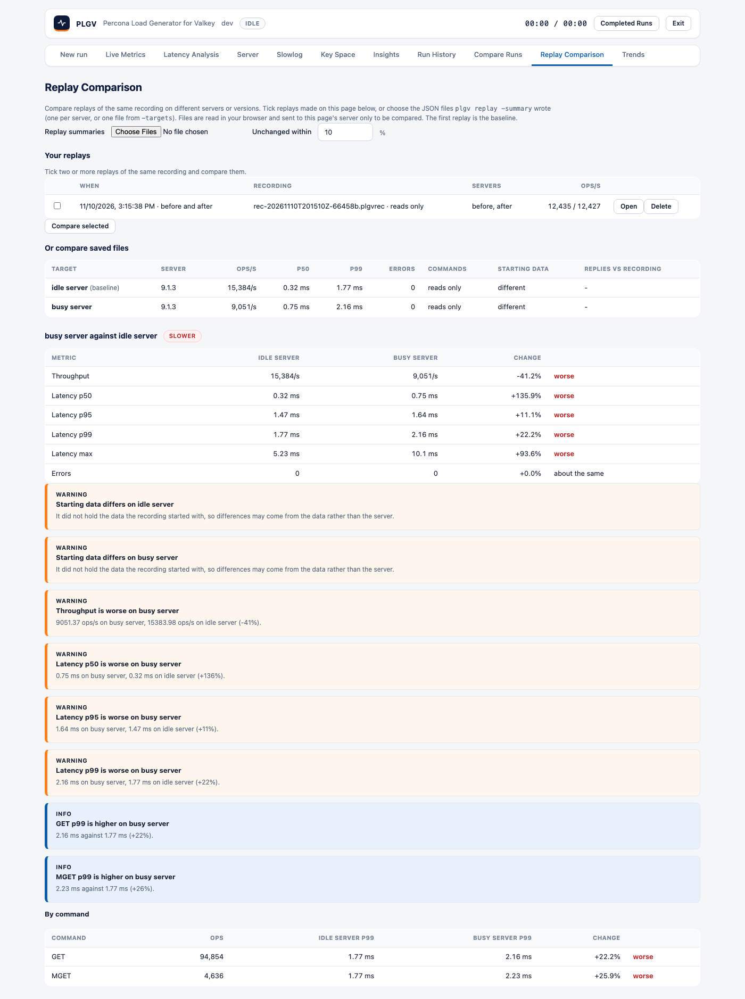

# Replay comparison

`plgv compare` and the **Replay Comparison** tab compare replays of the same recording: what is
faster or slower, whether anything returned different results, and whether the comparison can be trusted.



## Make the inputs

Each replay writes a summary with `-summary`:

```sh
plgv replay -label v8 -addr 10.0.0.1:6379 -speed 0 -summary v8.json run.jsonl.zst
plgv replay -label v9 -addr 10.0.0.2:6379 -speed 0 -summary v9.json run.jsonl.zst
```

or both at once from `-targets` (see `multi-target.md`). A summary holds totals, percentiles, per-command
latency, comparisons with the recording and the starting-data check. It holds no keys, values or
commands, and no credentials.

## Compare from the command line

```sh
plgv compare v8.json v9.json            # the first is the baseline
plgv compare both.json                  # a -targets file
plgv compare -tolerance 5 -json a.json b.json c.json
plgv compare -fail-on-regression v8.json v9.json   # exit 1 if slower, mixed or not comparable
```

| Flag | Meaning |
|---|---|
| `-tolerance P` | Percent a metric may change before it counts as better or worse (default 10). |
| `-json` | Print the comparisons as JSON. |
| `-fail-on-regression` | Exit 1 when a target is `slower`, `mixed` or `not comparable` against the first. |

## Compare in the web UI

Open the **Replay Comparison** tab. It lists the replays you ran from the page ([record-and-replay-web-ui.md](record-and-replay-web-ui.md)):
tick two or more and press **Compare selected**. You can also choose summary files written by `plgv replay -summary`:
they are read in your browser and sent to the server of that page only to be compared; nothing is stored and no file
on the server is read. Change *Unchanged within* to rerun the comparison with another tolerance.
`#replay=<base64url of a JSON array of summaries>` opens the tab with that comparison (used for the screenshot above).

## How to read it

- **Verdict** per target against the baseline: `faster`, `slower`, `mixed` (some of throughput, p50, p95 and p99
  better and some worse), `equivalent`, or `not comparable`.
- A metric is *better* or *worse* only when it changed by more than the tolerance **and** a latency by more than
  0.1 ms, so microsecond noise on a fast server is not reported. Errors compare exactly.
- **Not comparable** when the replays used different recordings (their command hashes differ) or one did not run.
  A comparison made with different `-speed` or `-reads-only` settings still runs, with a warning.
- **Findings** explain the verdict: worse and better metrics, more errors (critical when the baseline had none),
  replies that differ from the recording more often than on the baseline, a starting-data mismatch on either side,
  a paced replay that fell behind the recording, different server versions, and the three commands whose p99 got
  worse the most.
- **By command** lists each command's p99 on both sides.

A comparison is only as good as the replays: make them from the same starting data, with the same options,
on servers that are otherwise idle, and repeat a replay (`-iterations`) before trusting a small difference.
