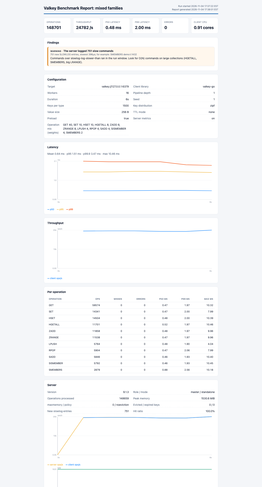

# Reports and exports

## HTML report

Every stored run has a self-contained HTML report. It's one file with its own styles and inline charts, and it
has no scripts and no external files. That means you can email it, attach it to a ticket, or print it to PDF
from the browser.

- Open it from the banner above a run, or click **Report** in Run History (`/api/runs/<id>/report`).
- **Download report** saves it as `plgv-report-<id>.html`.

The report includes:

- headline numbers (operations, throughput, p50, p99, errors, client CPU)
- findings, with evidence and advice
- the configuration of the run
- latency and throughput charts
- per-operation results and errors by class
- if server metrics were on, a server section (version, memory, hit ratio, evictions, charts) and the slowlog
  entries

All text from the run is escaped, and the report never includes credentials.

## JSON run summary

The full record of a run is a JSON file, either `<data-dir>/runs/<id>.json` or whatever you pass to `-summary`
on the command line. It holds the configuration as YAML, the client and server results, the time series, the
per-operation results and the findings. See [metrics-and-server-stats.md](metrics-and-server-stats.md).

Trends and Compare Runs both read this file. So if you want to move runs between machines, just copy the files
into the other machine's data directory.
