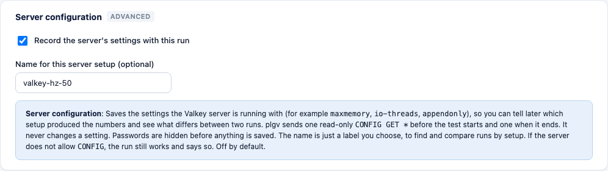
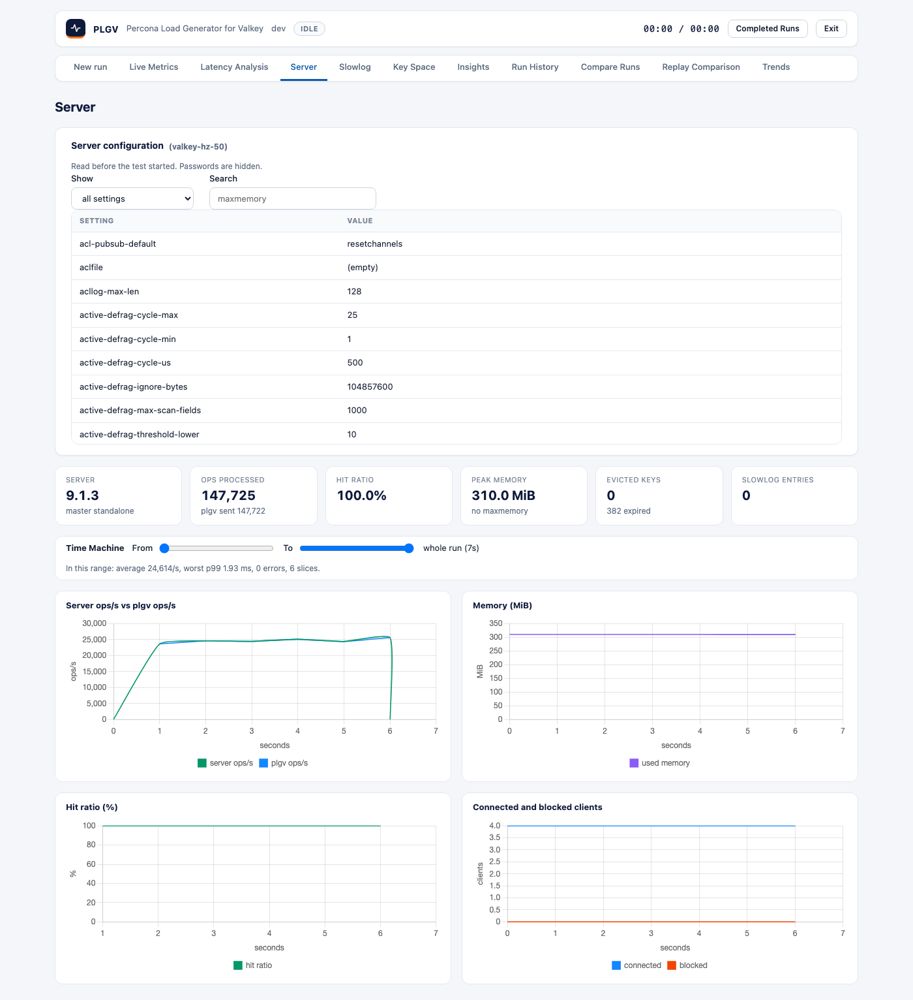

# Server configuration per run

Two runs can give different numbers because the **server** was set up differently, not because plgv or the
workload changed. This feature saves the settings the Valkey server was running with next to the results, so you
can look them up later and see what differs between two runs.

It is **off by default** and it only reads.

## What it does

- Before the test starts, plgv sends one read-only command, `CONFIG GET *`, and keeps the answer.
- When the test ends it sends it once more, and notes any setting that changed during the run.
- It never changes a setting.
- Passwords are hidden before anything is saved. Any setting whose name contains `pass` or `secret`, or ends in
  `auth` (for example `requirepass`, `masterauth`), is saved as `***`.
- You can give the setup a **name**, such as `valkey-9.1-io-threads-4`. The name is only a label you choose. It
  helps you find and compare runs later.

## Turn it on

**Web UI:** Settings, level Advanced, category "Metrics and reporting", tick
"Record the server's settings with this run". Type a name if you want one.



**CLI:**

```bash
./bin/plgv run -server-config                                  # record the settings
./bin/plgv run -server-config-name valkey-9.1-io4              # record them and name the setup
```

**Config file:**

```yaml
server_config:
  enabled: true
  name: valkey-9.1-io4
```

See `configuration-reference.md` for the keys and defaults.

## What you see

**In the terminal**, after the results:

```text
server config (valkey-9.1-io4):
  127.0.0.1:6379: 237 settings read; maxmemory="0" maxmemory-policy="noeviction" io-threads="1" appendonly="no" save="" hz="10" maxclients="10000"
  (all settings are in the run summary; secrets are masked)
```

**In the Web UI:**



- **Server tab:** a "Server configuration" card with every setting, in a scrolling list. You can search, choose which server to look at
  (in a cluster), and filter to "changed during the run" or "different between servers". The card appears even
  when "Collect server metrics" is off.
- **Run History:** a "Server setup" column, and a filter box once at least one run has a name (see
  [trends-and-history.md](trends-and-history.md)).
- **Compare Runs:** a "Server setting differences" table listing only the settings that differ, with each run's
  setup name in the column headings. If only one run recorded its settings, the page says so instead.

**In the run summary** (`-summary-file`, or the stored run): a `server_config` block with the name, the status,
and the settings for each server. Settings that normally differ between servers (ports, file paths, addresses)
are left out of the "different between servers" list.

## Cluster and Sentinel

In a cluster plgv reads every node it knows, and lists the settings that differ from node to node. This is a
quick way to spot a node that was set up differently. With Sentinel it reads the current primary.

## If the server does not allow `CONFIG`

Many managed services block `CONFIG`. The run still works. The terminal and the Server tab say the settings
were not recorded because the server does not allow `CONFIG GET` (or the user has no permission). Nothing is
saved except the name.

## Limits

- You get the values, not the server's defaults. plgv does not mark a setting as "changed from the default",
  because defaults differ between Valkey versions. Compare two runs instead.
- Settings that a managed service hides cannot be read.
- The name is a single label (80 characters at most). A named set of expected settings that plgv checks the
  server against is not part of this feature.
- The settings are not part of a run's workload fingerprint, so two runs of the same workload stay comparable
  even when the servers differ. That is the point of Compare Runs.
