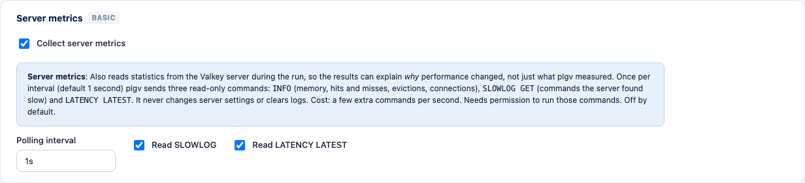
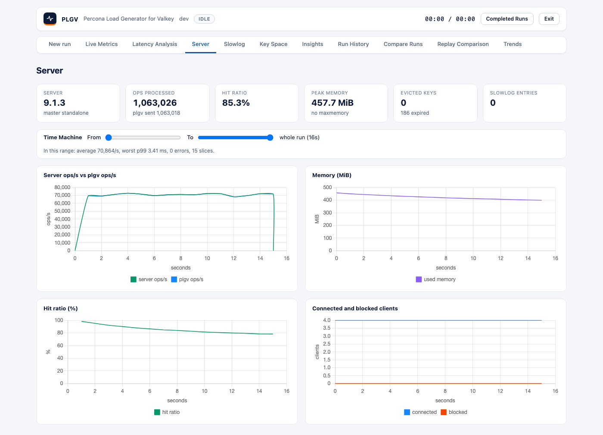
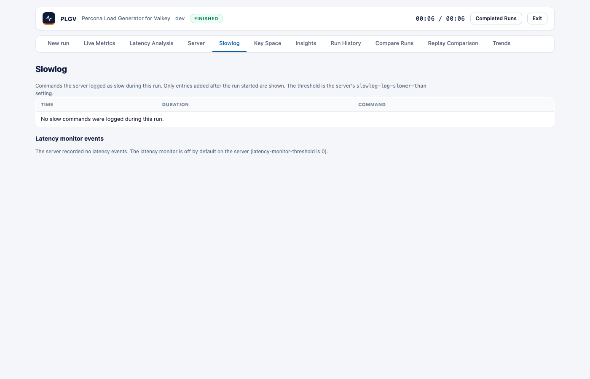
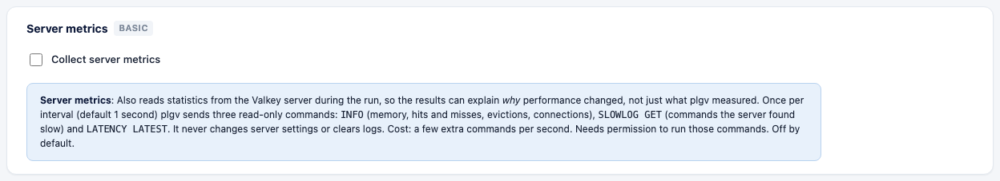

# Server metrics in the web UI

With server metrics on, plgv reads statistics from the Valkey server while a run is going, so the results can
explain *why* performance changed. They're **off by default**, and you turn them on with one checkbox.

## The checkbox

On the Settings page, the **Server metrics** card (a Basic setting) has the **Collect server metrics** checkbox.
Under it, you'll always see a note that says what it does:

> **Server metrics**: Also reads statistics from the Valkey server during the run, so the results
> can explain *why* performance changed, not just what plgv measured. Once per interval (default
> 1 second) plgv sends three read-only commands: `INFO` (memory, hits and misses, evictions,
> connections), `SLOWLOG GET` (commands the server found slow) and `LATENCY LATEST`. It never
> changes server settings or clears logs. Cost: a few extra commands per second. Needs
> permission to run those commands. Off by default.

When you tick it, three options appear: the **polling interval** (default 1s, minimum 100ms), and whether to
read **SLOWLOG** and **LATENCY LATEST**. The launch bar at the bottom says "server metrics on" or "off". In a
saved settings file, the setting is `server_metrics.enabled`.

## What changes when it is on

- **Server tab:** version, role and mode, the operations the server processed versus the operations plgv sent,
  hit ratio, peak memory and evictions. You also get charts of server ops/s next to plgv ops/s, memory, hit
  ratio, and connected and blocked clients.

- **Slowlog tab:** commands the server logged as slow *during the run* (older entries are ignored), plus any
  latency-monitor events. The tab shows the first 100 entries, and the report and the run's JSON hold more.
  plgv's own polling commands are never listed.

- **Insights:** plgv checks the server-side findings (evictions, memory near the limit, low hit ratio, slow
  commands, fork stalls, replication lag, rejected connections and others). See [insights.md](insights.md).
- **Compare Runs and the report** include the server numbers.

## Clusters and Sentinel

Against a cluster, server metrics also read every node (`INFO` per node) and the topology (`CLUSTER SHARDS`).
That adds a node table, per-node charts and failover markers. See [cluster-and-sentinel.md](cluster-and-sentinel.md).

## When it is off

The Server and Slowlog tabs tell you that server metrics were off for the run, and offer a button that takes
you to the checkbox. Insights notes that server findings weren't checked.

## Permissions and cost

plgv needs permission to run `INFO`, `SLOWLOG` and `LATENCY`. If the ACL denies one, plgv skips that source,
keeps going, and tells you ("some server metrics could not be read"). The cost is a few small commands per
second, on a connection shared with the workload.

You can get the same data from the command line with `-server-metrics`. See
[metrics-and-server-stats.md](metrics-and-server-stats.md).
