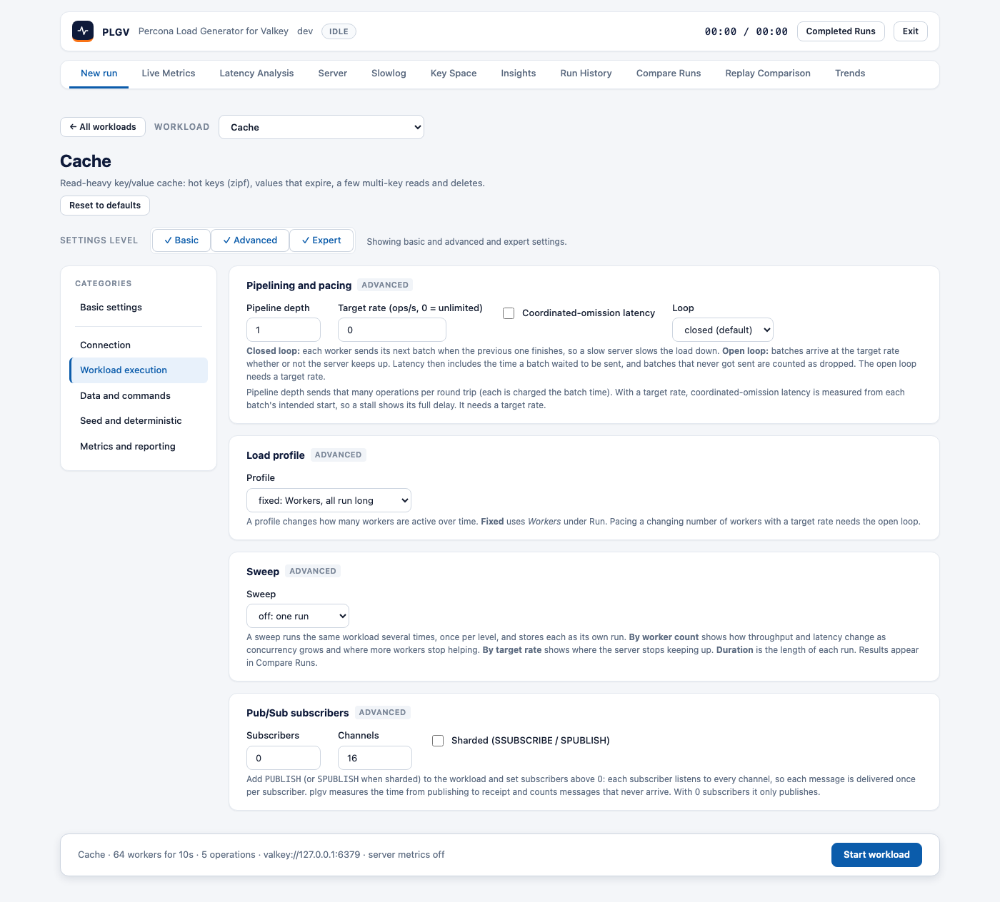
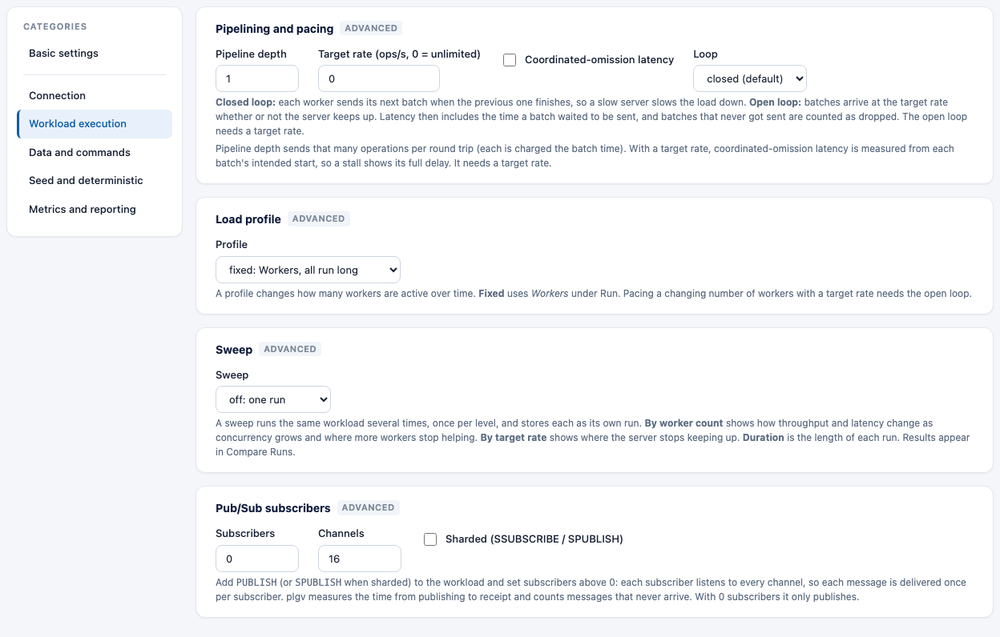

# Settings levels and categories

After you choose a workload (see [web-ui.md](web-ui.md#your-first-run)), its settings are grouped by
**level**, so the common ones are easy to find, and by **category**, so a long list never fills one page.

## Levels

The **Settings level** control above the settings has three toggles. Basic is always on; tick **Advanced**,
**Expert** or both to add more. Your choice is remembered in the browser.

| Level | What is in it |
|---|---|
| **Basic** | Server address and deployment, duration, workers, run label, the workload and operation mix, keys, distribution, value size, server metrics, and saved settings. |
| **Advanced** | Pipeline depth, target rate, coordinated-omission latency, loop, load profile, sweep, pub/sub subscribers, seed and deterministic traffic, raw commands, dataset details (prefix, zipf skew, collection size, hash fields, hash tags, TTL model, preload), TLS, key-space analysis, chart sample interval. |
| **Expert** | Client library (`valkey-go` or `go-redis`), slowlog entries per poll. |

With only **Basic** on, its cards are shown one under another.

## Categories

When **Advanced** or **Expert** is on, a **Categories** list appears on the left and shows one category at a
time, so no screen is long.

| Category | Holds |
|---|---|
| **Basic settings** | The Basic cards: server, run, workload, dataset, server metrics, save and load. |
| **Connection** | TLS and mutual TLS (Advanced), client library (Expert). See [security-tls-acl.md](security-tls-acl.md). |
| **Workload execution** | Pipelining and pacing, load profile, sweep, pub/sub subscribers (Advanced). See [load-profiles-and-sweep.md](load-profiles-and-sweep.md). |
| **Data and commands** | Dataset details, raw commands (Advanced). See [raw-injector.md](raw-injector.md). |
| **Seed and deterministic** | Random seed, operation budget and deterministic traffic (Advanced). See [deterministic-mode.md](deterministic-mode.md). |
| **Metrics and reporting** | Key-space analysis, chart sample interval (Advanced), slowlog polling (Expert). See [key-space-analysis.md](key-space-analysis.md). |

**Record a workload** adds a **Record** card to Basic settings. **Replay a recorded workload** shows only what a replay
uses: the Server card, *Recording to replay* and *Replay options* in Basic settings; Advanced adds TLS (Connection),
*Replay on several servers* and *Replay checks* (Workload execution) and *Import captured traffic* (Data and commands).
It has no Seed or Metrics category. See [record-and-replay-web-ui.md](record-and-replay-web-ui.md).

A category appears only when it has something to show at the levels you ticked. Turn a level off while you
are on one of its categories and the page returns to **Basic settings**.

Some workloads open the category they need. **Find the limit** turns Advanced on and opens
**Workload execution**, where its worker counts are; **Your own commands** opens **Data and commands**.

## Hidden settings still apply

Hiding a level, or looking at another category, only hides cards. Settings you cannot see are **not reset**:
they keep their current value and are used by the run. The note beside the level control says which levels
are hidden. The bar at the bottom summarizes what will run.

If a setting has a problem, the run does not start. The message appears under the field, the category that
holds it gets a red dot in the list, and the category of the first problem is opened for you. If the problem
is in a level that was off, that level is turned on so you can reach it.

## Saved settings

The **Save and load run settings** card (Basic settings) saves and reloads a whole configuration under a name.

- **Save current** stores the configuration as `<data-dir>/settings/<name>.yaml`. It uses the
  same YAML as `plgv run -config`, so a saved setting can also be used on the command line.
- **Load** puts a saved configuration into the form; **Delete** removes it.
- Names are 1 to 64 characters (letters, digits, space, dot, dash, underscore).
- Credentials are never saved.
- A configuration that fails validation cannot be saved; the error is shown.
