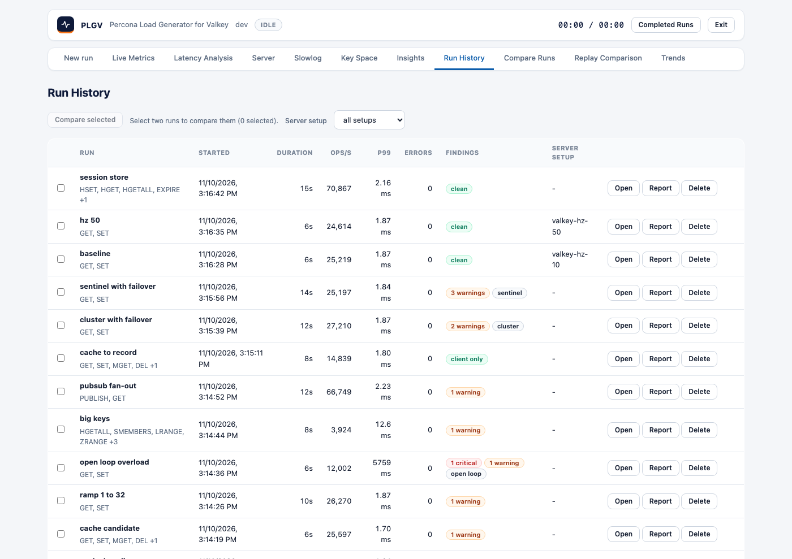
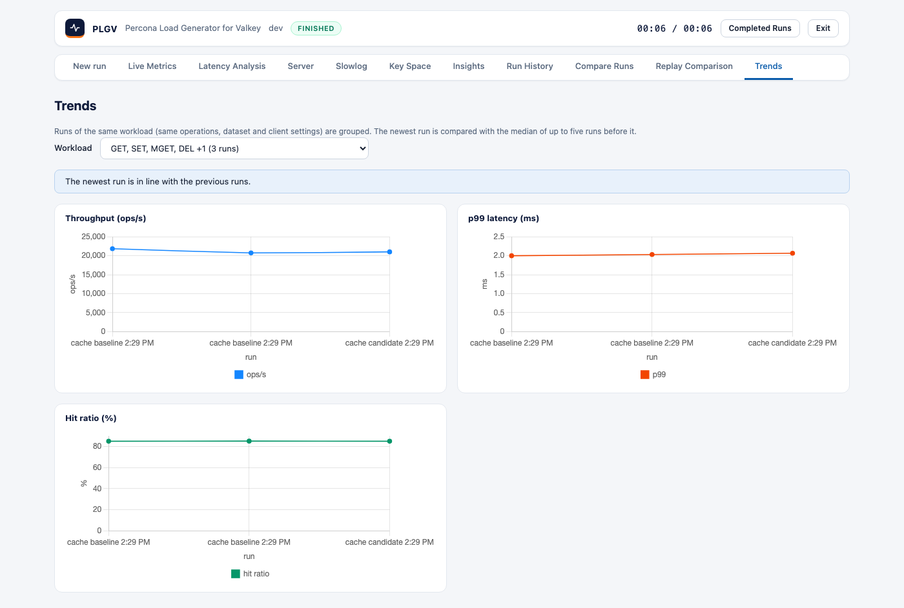

# Run history and trends

Every finished run, including one you stop early, is saved to `<data-dir>/runs/` as a JSON file and listed in
**Run History**. plgv keeps the newest 100 (change that with `-keep-runs`).

## Run History

Each row shows the run's name (its label, or its id), the operation mix, when it started, its duration,
throughput, p99, errors and finding chips. The chips say `clean`, `client only`, or give counts of warnings and
critical findings. A run that ended early is marked `stopped`.

| Action | What it does |
|---|---|
| **Open** | Loads the run into Live Metrics, Latency Analysis, Server, Slowlog and Insights. |
| **Report** | Opens the [HTML report](reports-and-exports.md) in a new tab. |
| **Delete** | Removes the run after a confirmation. |
| Checkboxes | Select two runs, then **Compare selected** ([compare-runs.md](compare-runs.md)). |

To make a run easy to find later, give it a **Run label** on the Settings page.

## Trends

Trends charts the same workload over time. Runs are grouped by **workload fingerprint**, which is the operation
mix, dataset, pipeline depth and client library. The server address, duration, seed and server-metrics setting
aren't part of it, so you can compare the same workload across servers and run lengths.

- Pick a workload from the list, and the charts show throughput, p99 latency and hit ratio for each run.
- A workload needs at least **3** runs before it can be charted.
- Runs that were stopped early are left out, because their numbers aren't comparable.

### Regression flags

plgv compares the newest run with the **median of up to five runs before it**. A flag appears when:

| Metric | Flagged when |
|---|---|
| p99 latency | 20% or more higher |
| Throughput | 10% or more lower |
| Hit ratio | 5 points or more lower (needs server metrics on those runs) |
| Error rate | 0.1 percentage points or more higher |

If nothing is flagged, the page says the newest run is in line with the previous runs. A flag is a hint that
something changed and is worth a look. Run-to-run noise on a busy machine can also trigger one.
