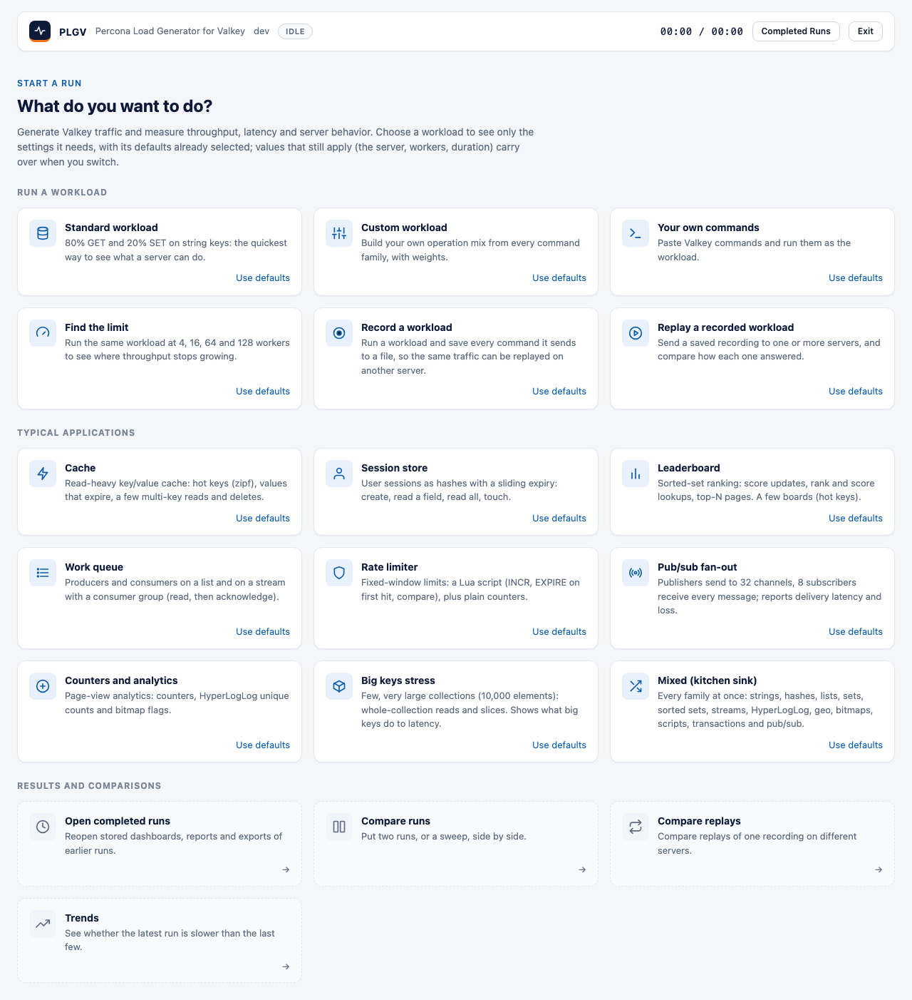
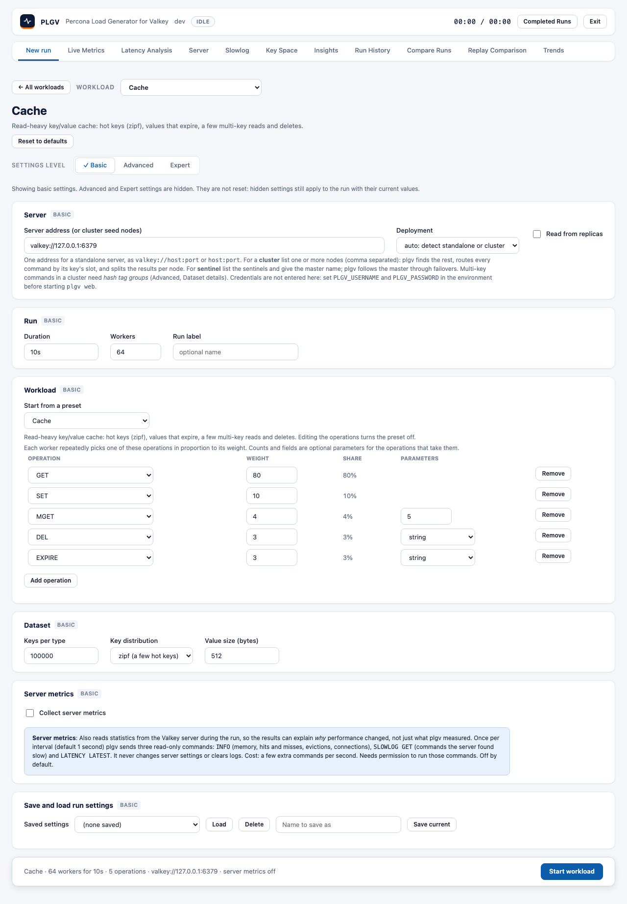
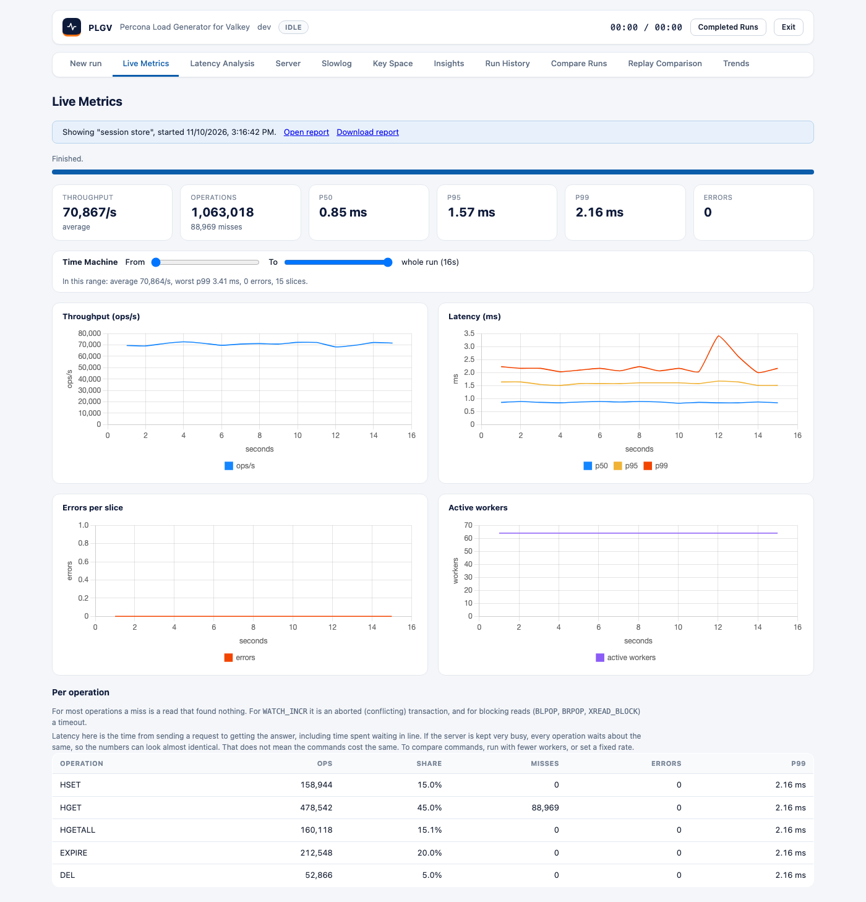
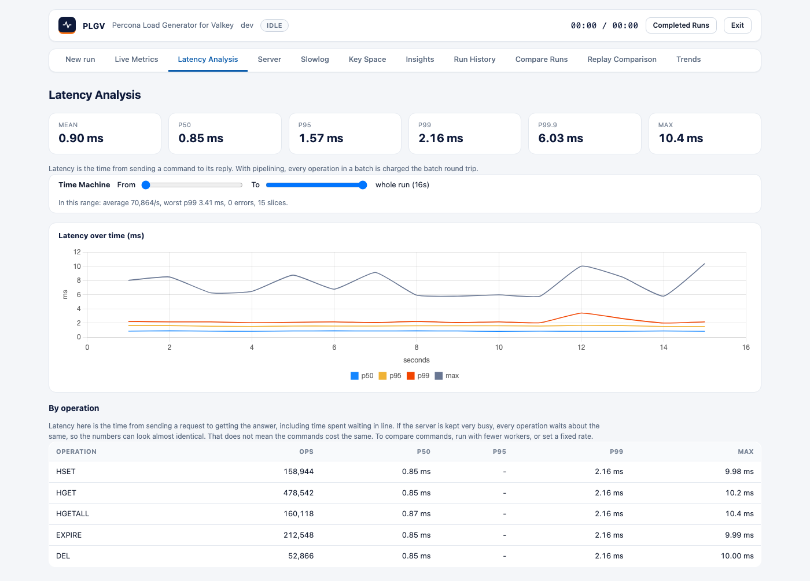

# Web UI

The web UI runs workloads, shows them live, and keeps every finished run so you can reopen, compare and chart
them later. It's one page served by the plgv binary, so there's nothing extra to install and it doesn't need
network access (the chart library is bundled).

## Start it

```bash
make valkey-up              # a Valkey to test against (see VALKEY_TEST_ENV.md)
make build-local
./bin/plgv web              # then open http://127.0.0.1:8080
```

| Flag | Default | Meaning |
|---|---|---|
| `-addr` | `127.0.0.1:8080` | Listen address. |
| `-data-dir` | `plgv-data` | Where finished runs (`runs/`) and saved settings (`settings/`) are kept. |
| `-keep-runs` | 100 | How many of the newest finished runs to keep. Older ones are deleted, and 0 keeps all. |
| `-open` | off | Open the page in your browser. |
| `-allow-remote` | off | Allow a non-loopback address. See Security. |
| `-allowed-host` | empty | Host names the UI answers to, for example `localhost,127.0.0.1` behind a port published on loopback only. |

You don't type credentials for the server under test into the page. Set `PLGV_USERNAME` and `PLGV_PASSWORD` in
the environment before you start `plgv web`.

## Your first run

The front page asks **What do you want to do?** and shows a card for each kind of workload.



| Card | Use it to |
|---|---|
| **Standard workload** | Run 80% `GET` and 20% `SET` on string keys. It's the quickest way to see what a server can do. |
| **Custom workload** | Build your own operation mix from every command family ([custom-workload-builder.md](custom-workload-builder.md)). |
| **Your own commands** | Paste Valkey commands and run them as the workload ([raw-injector.md](raw-injector.md)). |
| **Find the limit** | Run the same workload at 4, 16, 64 and 128 workers ([load-profiles-and-sweep.md](load-profiles-and-sweep.md)). |
| **Record a workload** | Run a workload and save every command to a file ([record-and-replay-web-ui.md](record-and-replay-web-ui.md)). |
| **Replay a recorded workload** | Send a recording to one or more servers and compare them ([record-and-replay-web-ui.md](record-and-replay-web-ui.md)). |
| **Cache, Session store, Leaderboard, Work queue, Rate limiter, Pub/sub fan-out, Counters and analytics, Big keys stress, Mixed** | Run a typical application's traffic ([presets.md](presets.md)). |
| **Open completed runs**, **Compare runs**, **Compare replays**, **Trends** | Go to the results sections. |

1. **Click a card.** Its settings open with the defaults for that workload already selected: the operations,
   the dataset, and the worker count it needs. If you switch to another workload, the server, workers and
   duration you already set carry over. Use the **Workload** list at the top of the settings to switch.
2. Check the **Server address** and change anything you like. To start a workload from its defaults again, press
   **Use defaults** on a card, or **Reset to defaults** under the title. Your server address is kept.
3. The bar at the bottom shows what will run, for example `Cache · 64 workers for 10s · 5 operations · valkey://127.0.0.1:6379 · server metrics off`.
   Click **Start workload**, and the page moves to Live Metrics.
4. The status badge in the header shows `connecting`, `preloading dataset` (not measured), `running`, and then
   `finished`. The clock beside it shows elapsed and planned time. **Stop** ends the run early, and the partial
   run is saved and marked "stopped early".
5. When the run finishes, it opens automatically and is saved to Run History (**Completed Runs** in the header).



The settings are grouped by level and category. Basic settings fit on one screen, and **Advanced** and **Expert**
add a category list on the left, showing one category at a time ([settings-levels.md](settings-levels.md)). The
workload cards are locked while a run is going. **Exit** in the header stops the plgv server (it asks first).

Only one run can be active at a time. If a setting isn't valid, the run won't start, and each problem is shown
next to its field. The category that holds it is marked, and a hidden Advanced or Expert level is turned on so
you can reach it.

## The tabs

Once you've chosen a workload, a row of tabs appears under the header. The brand (**PLGV**) and **All workloads** take you back to the front page.

| Tab | What it shows | Page |
|---|---|---|
| **New run** | The settings of the chosen workload, at three levels and in categories, plus saved settings. | [settings-levels.md](settings-levels.md), [custom-workload-builder.md](custom-workload-builder.md), [server-metrics.md](server-metrics.md) |
| **Live Metrics** | Throughput, latency, errors and the per-operation table, updating while the run goes. | below |
| **Latency Analysis** | Percentiles, latency over time and per-operation latency for a finished run. | below |
| **Server** | Server-side charts (ops/s, memory, hit ratio, clients). For a cluster, it also shows the nodes table, topology changes and per-node charts. Needs server metrics. | [server-metrics.md](server-metrics.md), [cluster-and-sentinel.md](cluster-and-sentinel.md) |
| **Slowlog** | Commands the server found slow during the run. Needs server metrics. | [server-metrics.md](server-metrics.md) |
| **Key Space** | Types, sizes, expiry and the biggest keys after a run. | [key-space-analysis.md](key-space-analysis.md) |
| **Insights** | Findings with evidence and advice. | [insights.md](insights.md) |
| **Run History** | Every finished run; open, report, delete, pick two to compare. | [trends-and-history.md](trends-and-history.md) |
| **Replay Comparison** | Your replays, and files from `plgv replay -summary`, compared. | [replay-comparison.md](replay-comparison.md), [record-and-replay-web-ui.md](record-and-replay-web-ui.md) |
| **Compare Runs** | Two runs side by side, and sweep results. | [compare-runs.md](compare-runs.md), [load-profiles-and-sweep.md](load-profiles-and-sweep.md) |
| **Trends** | The same workload over time, with regression flags. | [trends-and-history.md](trends-and-history.md) |

## Live Metrics



- **Cards:** throughput, operations (with misses), p50, p95, p99 and errors. While a run is going, they show the
  latest one-second slice. For a finished run, they show the whole-run figures.
- **Charts:** throughput, latency (p50, p95, p99) and errors per slice.
- **Per operation:** operations, share, misses, errors and p99 for every entry of the mix.
- **Banner:** when you're looking at a stored run, the banner links to its [HTML report](reports-and-exports.md).

## Latency Analysis



This tab shows the whole-run mean, p50, p95, p99, p99.9 and max, latency over time, and per-operation
percentiles. A note says how latency was measured: service time, or coordinated-omission aware if you set a
target rate and that option. With pipelining, every operation in a batch is charged the batch round trip.

## Presets and key space

*Workload* offers **Start from a preset** ([presets.md](presets.md)). If you turn on *Key-space analysis*
(Advanced), the **Key Space** tab shows the types, sizes, expiry and biggest keys of a finished run
([key-space-analysis.md](key-space-analysis.md)).

## Advanced commands and raw commands

The mix builder offers streams, geo, HyperLogLog, bitmaps, scripts, pub/sub, transactions and raw commands.
Advanced settings add pub/sub subscribers and a raw command box, and Latency Analysis shows pub/sub delivery.
See [advanced-commands.md](advanced-commands.md) and [raw-injector.md](raw-injector.md).

## Time Machine

On Live Metrics, Latency Analysis and Server, two sliders let you choose a time range. The charts zoom to it, and
a line gives the statistics for just that range. See [load-profiles-and-sweep.md](load-profiles-and-sweep.md#time-machine).

## Links to a view

The address bar supports a few shortcuts, which are handy for sharing or for documentation:
`#tab=history`, `#run=<run id>&tab=server`, `#compare=<id>,<id>`, `#tab=settings&levels=advanced,expert`
`#srv=on`, `#sweep=<sweep id>`, `#run=<id>&tab=live&range=2-10`, and `#task=record` or `#task=replay` to open those workloads, `#set=path:value,...` to pre-fill settings (lists use `;`, for example `#set=target.uris:127.0.0.1:7001;127.0.0.1:7002`).

## Security

The UI has **no login**, and it can run load against any server the machine can reach. Because of that,
`plgv web` does a few things to protect you:

- It refuses a non-loopback address unless you pass `-allow-remote`.
- It only answers requests addressed to `localhost`, `127.0.0.1` or `[::1]`, so a web page on another domain
  can't drive it through DNS rebinding.
- It rejects requests that don't come from its own page (a different origin, or a body that isn't JSON).
- It sends a strict Content-Security-Policy.

If you expose it beyond your machine, put it behind your own access control and read `security-tls-acl.md`.
Settings include an Advanced **Encryption (TLS)** card.

Recording and replay write and read files on the machine running `plgv web`. The server names new recordings
inside `<data-dir>/recordings`, and it only accepts a typed path while it listens on loopback (see
[record-and-replay-web-ui.md](record-and-replay-web-ui.md#where-files-live-and-typed-paths)).

Saved settings and stored runs never contain credentials.

## Design

The page follows a small token-based design system. See [web-ui-design-system.md](web-ui-design-system.md).
